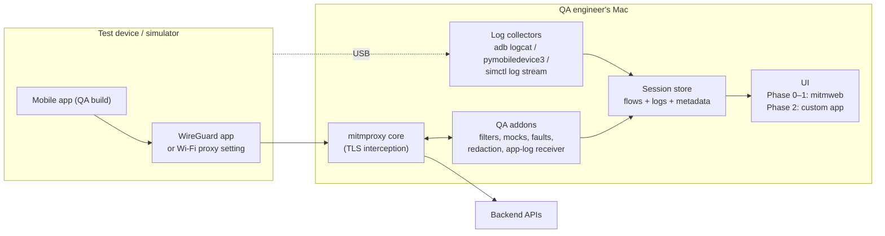

# Wiretrace — Plan for a Mobile Traffic & Log Inspection Tool (macOS)

## 1. Summary

Wiretrace is an internal macOS tool for the mobile QA team to:

- See every API request and response between the mobile app (iOS / Android) and backend servers.
- Filter and search that traffic quickly (by host, path, method, status code, body content).
- Change traffic for testing: mock responses, inject errors, add latency.
- See the app's logs next to its network traffic, on one timeline.
- Export evidence (HAR, cURL, logs) to attach to bug tickets.

The tool is built on top of **mitmproxy** (open source, MIT license) rather than writing an intercepting proxy from scratch. Our own code focuses on QA workflows: presets, filters, mocks, fault injection, log collection, and a simple UI.

The tool installs and runs **without a Mac admin account** (everything lives in the user's home folder). Only optional extras such as Xcode for the iOS Simulator need one-time help from IT.

### Related documents

| Document | Contents |
|---|---|
| [`docs/diagrams.md`](docs/diagrams.md) | QA workflows, setup and troubleshooting flows, sequence diagrams, component and deployment diagrams, network ports, session lifecycle, data model, timeline |
| [`docs/install-without-admin.md`](docs/install-without-admin.md) | What needs admin rights and what doesn't, install steps for standard users, iOS Simulator options, what to ask IT for |
| [`mockups/README.md`](mockups/README.md) | UI mockups of the Phase 2 desktop app (main window, device setup wizard, rules editor, bug report, menu bar) |

---

## 2. Goals and non-goals

### Goals

- Setup on a new test device in **under 5 minutes**, with a written guide.
- Works for **iOS devices, iOS Simulator, Android devices, Android emulator**.
- Works for apps that ignore the system proxy (Flutter, some React Native libraries).
- QA can decrypt **only our API hosts**, so third-party traffic does not add noise or break.
- Logs and traffic from the same session can be exported together in one bug report.
- Free to use, no per-seat license.

### Non-goals

- Bypassing certificate pinning in production builds. We rely on QA builds with pinning disabled.
- Intercepting traffic on devices the team does not control.
- Replacing backend monitoring or APM tools.
- Load or performance testing.

---

## 3. Build vs. buy

| Option | Cost | Pros | Cons |
|---|---|---|---|
| Charles Proxy | ~USD 50 per user (one-time) | Mature, well known | Dated UI, no custom workflows, no log integration |
| Proxyman | Free tier + paid license | Native macOS, polished | Advanced features paid, no custom workflows |
| HTTP Toolkit | Free tier + Pro subscription | Open source, modern UI | Some features (e.g. saved rules) are Pro |
| **mitmproxy + our own layer (this plan)** | Developer time only | Free, scriptable, custom QA features, log integration | We own maintenance |

**Decision point:** Phase 0 below costs 1–2 days and tells us whether plain mitmproxy already covers most needs. Only continue to Phase 1 and Phase 2 if the team wants features the existing tools don't offer (project presets, shared mocks, logs + traffic timeline, ticket export).

---

## 4. Architecture



### Components

| Component | Responsibility |
|---|---|
| **mitmproxy core** | Accepts traffic, decrypts HTTPS using its own CA, supports HTTP/1.1, HTTP/2, WebSockets. |
| **QA addons** (Python) | Our logic inside mitmproxy: host allowlist, presets, mocks, fault injection, redaction, request-ID tagging, in-app log receiver. |
| **Log collectors** (Python) | Background processes that stream device logs filtered to the app under test. |
| **Session store** | One folder per test session containing flows (`.mitm` + HAR), logs (`.jsonl`), and metadata (device, build, preset). |
| **UI** | Phase 0–1: mitmproxy's built-in web UI (`mitmweb`). Phase 2: our own UI with traffic + logs on one timeline. |
| **Launcher** | One command (later a menu-bar app) that starts the proxy, collectors, and UI with a chosen preset. |

---

## 5. Technology stack

| Area | Choice | Reason |
|---|---|---|
| Proxy engine | mitmproxy 11+ | Mature, scriptable, WireGuard mode, MIT license |
| Addons & collectors | Python 3.12 | Same language as mitmproxy's addon API |
| Python environment | `uv` (or `venv` + `pip`) | Installs without admin rights (Homebrew needs admin), and a project venv can import extra packages, which Homebrew's mitmproxy cannot |
| Android logs | `adb` (Android platform-tools) | Standard tool |
| iOS device logs | `pymobiledevice3` | Supports recent iOS versions, pure Python |
| iOS Simulator logs | `xcrun simctl` | Ships with Xcode |
| Config / presets | YAML (`pyyaml`) | Readable by QA, easy to review in git |
| Phase 2 UI | React + TypeScript, packaged with **Tauri** | Small app size, native macOS window, can bundle the Python backend as a sidecar |
| Phase 2 UI ↔ backend | Local WebSocket + REST (FastAPI or mitmproxy's own server) | Live streaming of flows and logs |

`requirements.txt`:

```text
mitmproxy>=11
pyyaml>=6
pymobiledevice3>=4
httpx>=0.27      # YouTrack / issue tracker API
keyring>=25      # stores tracker tokens in the macOS Keychain (no admin needed)
```

---

## 6. Device setup

Device setup is where most problems happen. The guide below becomes `docs/device-setup.md` for QA.

### 6.1 Recommended: WireGuard mode (iOS and Android)

1. On the Mac: `mitmweb --mode wireguard` (the launcher does this).
2. On the phone: install the **WireGuard** app from the App Store / Play Store.
3. Scan the QR code shown in the mitmweb UI and enable the tunnel.
4. Install the CA certificate (section 6.3).

Why WireGuard mode:

- No need to edit Wi-Fi proxy settings on each network.
- Catches apps that ignore the system proxy (Flutter, some React Native networking).
- Easy to switch on/off from the WireGuard app.

### 6.2 Alternative: Wi-Fi proxy

1. Mac and phone on the same Wi-Fi network.
2. Start `mitmweb` (regular mode, port 8080).
3. On the phone, set the Wi-Fi HTTP proxy to `<Mac IP>:8080`.
4. Allow incoming connections when the macOS firewall asks.

### 6.3 Installing the CA certificate

| Target | Steps |
|---|---|
| **iOS device** | With traffic going through the proxy, open `http://mitm.it` in Safari → download the iOS profile → Settings → General → VPN & Device Management → install → Settings → General → About → Certificate Trust Settings → enable full trust. |
| **iOS Simulator** | `xcrun simctl keychain booted add-root-cert ~/.mitmproxy/mitmproxy-ca-cert.pem` (script: `scripts/install-ca-simulator.sh`). The simulator uses the Mac's network, so the Mac's system proxy must point to Wiretrace. Changing it usually needs admin rights; see [options without admin](docs/install-without-admin.md#ios-simulator-without-admin). |
| **Android device** | Open `http://mitm.it` → download the Android cert → Settings → Security → Install certificate → CA certificate. **The app must be a QA build that trusts user CAs** (section 7). |
| **Android emulator** | Same as device. Use `10.0.2.2:8080` as the proxy address, or WireGuard mode. |

### 6.4 Removing the setup after testing

- Disable/delete the WireGuard tunnel or remove the Wi-Fi proxy.
- Delete the mitmproxy profile/certificate from the device.

---

## 7. Requirements for the mobile development team

These small changes in **QA / debug builds only** make the tool reliable. They should be agreed once and kept in every QA build.

| # | Requirement | Platform | Why |
|---|---|---|---|
| R1 | Trust user-installed CAs in QA builds via `network_security_config.xml` with `<debug-overrides>` (or a QA build flavor config). | Android | Android 7+ apps ignore user CAs by default; without this, HTTPS traffic cannot be decrypted. |
| R2 | Disable certificate pinning in QA builds. | iOS, Android | Pinning blocks interception by design. |
| R3 | Send an `X-Request-ID` header (UUID) on every API call, and include the same ID in related log lines. | iOS, Android | Lets the tool link a request to the app's logs. |
| R4 | Use `os_log` / `Logger` with **public** values in QA builds (not only `print()`). | iOS | `print()` does not appear in the device log; private values show as `<private>`. |
| R5 | Keep debug/info logs in QA builds (don't strip them with R8/ProGuard rules or logging config). | Android | Release-style builds often remove logs. |
| R6 (optional) | In QA builds, also send log lines as `POST https://qa-logs.internal/log` (JSON). Fire-and-forget, ignore failures. | iOS, Android | Gives logs over the network, no USB cable needed (section 9.6). |
| R7 | If the app uses Flutter/Dart `HttpClient` or another client that ignores the system proxy, confirm WireGuard mode works, or add a debug-only proxy setting. | Flutter, RN | These clients don't follow the phone's proxy settings. |

Example for R1 (`res/xml/network_security_config.xml`):

```xml
<network-security-config>
    <debug-overrides>
        <trust-anchors>
            <certificates src="user" />
        </trust-anchors>
    </debug-overrides>
</network-security-config>
```

---

## 8. Features and phases

### Phase 0 — Evaluate plain mitmproxy (1–2 days)

| Feature | How |
|---|---|
| Intercept traffic | `uv tool install mitmproxy` (no admin needed), `mitmweb --mode wireguard` |
| Filter traffic | mitmweb filter expressions (Appendix B) |
| Decrypt only our APIs | `--allow-hosts '(^|\.)myapp\.com(:\d+)?$'` |
| Export | mitmweb: export flow as cURL / HAR; save session `.mitm` file |
| Logs | Run `adb logcat` / `pymobiledevice3 syslog live` manually in Terminal |

**Deliverables**

- Device setup guide (draft).
- List of QA team needs that plain mitmproxy doesn't meet.
- Go / no-go decision for Phase 1.

**Exit criteria**

- QA can see decrypted API traffic from at least one iOS device, one Android device, and the iOS Simulator using a QA build.

---

### Phase 1 — QA addons, presets, log collection, launcher (2–3 weeks)

| ID | Feature | Description |
|---|---|---|
| F1 | Presets | YAML file per project/environment: API hosts, default filter, mocks folder, redaction rules. Selected at launch: `./wiretrace start --preset staging`. |
| F2 | Host allowlist | Only preset hosts are decrypted and shown; everything else is passed through untouched. |
| F3 | Mocks (map local) | JSON files in `mocks/<preset>/<METHOD>/<path>.json` replace the backend response. Mocked flows are marked in the UI. |
| F4 | Fault injection | Per path: force HTTP status (500, 401, 404…), add delay, drop connection. Changeable at runtime from mitmweb's Options panel. |
| F5 | Redaction | `Authorization`, `Cookie`, `Set-Cookie`, and configured JSON fields are masked in exports. |
| F6 | Request ID tagging | Read `X-Request-ID`, show it as a flow comment, store it for log matching. |
| F7 | Android log collector | Stream `adb logcat` for the app's package; re-resolve the PID when the app restarts. |
| F8 | iOS log collector | Stream `pymobiledevice3 syslog live` (device) or `simctl log stream` (simulator), filtered to the app process. |
| F9 | In-app log receiver | Catch `POST qa-logs.internal/log` from the app (R6), store it, return `204`, never forward it. |
| F10 | Session folder | Each run creates `sessions/<date>_<preset>_<device>/` with `flows.mitm`, `flows.har`, `device.log.jsonl`, `app.log.jsonl`, `meta.json`. |
| F11 | Bug report export | `./wiretrace report <session>` → zip with redacted HAR, logs, and a short summary of failed requests (4xx/5xx). |
| F12 | Launcher | One command starts mitmweb + addons + the correct log collector, prints setup instructions and the WireGuard QR code location. |
| F13 | Post bug to YouTrack | `./wiretrace report <session> --youtrack` creates a YouTrack issue with a pre-filled description (environment, failed request, redacted response, related logs), attaches the report zip and screenshot, sets type/priority/tag, and prints the issue link. See section 9.8. |

**Exit criteria**

- A QA engineer can go from "fresh Mac" to "seeing filtered API traffic and app logs" by following the guide, without help.
- Mocks and fault injection work on both iOS and Android.
- A bug report zip contains redacted traffic and logs from the same session.

---

### Phase 2 — Custom desktop UI (4–6 weeks, only if needed)

Start this phase only if mitmweb's UI is a real limitation for the team.

| ID | Feature | Description |
|---|---|---|
| U1 | macOS app | Tauri app with the Python backend bundled as a sidecar. Signed and notarized. |
| U2 | Device setup wizard | Shows WireGuard QR code, CA install steps per platform, live "traffic received" check. |
| U3 | Traffic list | Columns: time, method, host, path, status, duration, size, mocked/faulted badges. |
| U4 | Quick filters | Chips for: errors only (4xx/5xx), slow (> N ms), mocked, by endpoint; free-text search in bodies. Saved filters per preset. |
| U5 | Request/response viewer | Pretty JSON with folding, headers table, cURL copy, "copy as mock" button. |
| U6 | Unified timeline | Traffic and logs on one timeline; selecting a request highlights logs with the same `X-Request-ID` or within ±N seconds. |
| U7 | Log panel | Filter by level, tag, text; color by level; crash lines highlighted. |
| U8 | Mock & fault editor | Create/edit mocks and fault rules from the UI, no file editing needed. |
| U9 | Response diff | Compare the same endpoint between two sessions or two environments. |
| U10 | Bug report button | One click → redacted report posted as a **YouTrack** issue (project, type, priority chosen in the dialog), or saved as a zip. Jira/GitLab can be added later through the same tracker interface. |

**Exit criteria**

- QA prefers the custom UI over mitmweb in a 1-week trial.
- App installs and runs on a clean Mac without Terminal commands.

---

### Phase 3 — Optional extras (later)

- Breakpoints: pause a request/response and edit it before it continues.
- Shared mock library in a git repo, synced across the team.
- Scenario scripts: e.g. "first call to `/orders` returns 500, second returns 200".
- Automation hook: start/stop sessions from UI test runs (Appium, XCUITest, Espresso) and attach the session to the test report.
- gRPC / Protobuf decoding if the backend uses it.

---

## 9. Implementation details

### 9.1 Project structure

```text
wiretrace/
├── README.md
├── requirements.txt
├── wiretrace                      # launcher CLI (Python, executable)
├── addons/
│   ├── __init__.py
│   ├── qa_tools.py               # presets, allowlist, mocks, faults, request IDs
│   ├── redact.py                 # redaction for exports
│   ├── app_logs.py               # in-app log receiver (qa-logs.internal)
│   └── session.py                # session folder, writes HAR + metadata
├── collectors/
│   ├── android_logcat.py
│   ├── ios_device_syslog.py
│   └── ios_simulator_log.py
├── trackers/
│   ├── base.py                   # Tracker interface: create_issue(report) -> url
│   ├── youtrack.py               # YouTrack REST API
│   └── report_template.md        # issue description template
├── presets/
│   ├── dev.yaml
│   └── staging.yaml
├── mocks/
│   └── staging/
│       └── GET/
│           └── api_v1_profile.json
├── scripts/
│   ├── install-ca-simulator.sh
│   └── setup-mac.sh              # installs uv, adb, Python deps
├── docs/
│   ├── device-setup.md
│   ├── dev-team-requirements.md
│   └── filters-cheatsheet.md
├── sessions/                     # gitignored
└── ui/                           # Phase 2 (Tauri + React)
```

### 9.2 Preset file

```yaml
# presets/staging.yaml
name: staging
app:
  android_package: com.mycompany.myapp
  ios_process: MyApp
api_hosts:
  - api-staging.mycompany.com
  - auth-staging.mycompany.com
default_filter: "~s & !~t image"
mocks_dir: mocks/staging
redact:
  headers: [Authorization, Cookie, Set-Cookie]
  json_fields: [password, accessToken, refreshToken, otp]
```

### 9.3 Core addon (presets, allowlist, mocks, faults, request IDs)

```python
# addons/qa_tools.py
import asyncio
from pathlib import Path

import yaml
from mitmproxy import ctx, http


class QATools:
    def __init__(self):
        self.preset: dict = {}

    def load(self, loader):
        loader.add_option("qa_preset", str, "staging", "Preset name in presets/")
        loader.add_option("qa_fail_path", str, "", "Path that returns qa_fail_status")
        loader.add_option("qa_fail_status", int, 500, "Status code for qa_fail_path")
        loader.add_option("qa_delay_ms", int, 0, "Extra latency for API calls")

    def configure(self, updated):
        if "qa_preset" in updated:
            path = Path("presets") / f"{ctx.options.qa_preset}.yaml"
            self.preset = yaml.safe_load(path.read_text())
            ctx.log.info(f"QA preset loaded: {self.preset['name']}")

    def _is_api(self, flow: http.HTTPFlow) -> bool:
        host = flow.request.pretty_host
        return any(host == h or host.endswith("." + h) for h in self.preset["api_hosts"])

    def _mock_file(self, flow: http.HTTPFlow) -> Path:
        path = flow.request.path.split("?")[0].strip("/").replace("/", "_")
        return Path(self.preset["mocks_dir"]) / flow.request.method / f"{path}.json"

    async def request(self, flow: http.HTTPFlow):
        if not self._is_api(flow):
            return

        request_id = flow.request.headers.get("X-Request-ID")
        if request_id:
            flow.comment = f"request-id: {request_id}"

        if ctx.options.qa_delay_ms:
            await asyncio.sleep(ctx.options.qa_delay_ms / 1000)

        path = flow.request.path.split("?")[0]
        if ctx.options.qa_fail_path and path == ctx.options.qa_fail_path:
            flow.response = http.Response.make(
                ctx.options.qa_fail_status,
                b'{"error":"injected by Wiretrace"}',
                {"Content-Type": "application/json"},
            )
            flow.marked = ":boom:"
            return

        mock = self._mock_file(flow)
        if mock.exists():
            flow.response = http.Response.make(
                200, mock.read_bytes(), {"Content-Type": "application/json"}
            )
            flow.marked = ":construction:"


addons = [QATools()]
```

Notes:

- The host allowlist for **decryption** is passed to mitmproxy by the launcher as `--allow-hosts`, built from `api_hosts`. The check in `_is_api` decides which flows get QA features.
- `async def request` with `asyncio.sleep` adds latency without blocking other requests.

### 9.4 Redaction (for exports)

```python
# addons/redact.py
import json

MASK = "***"


def redact_headers(headers: dict, names: list[str]) -> dict:
    lowered = {n.lower() for n in names}
    return {k: (MASK if k.lower() in lowered else v) for k, v in headers.items()}


def redact_json(body: str, fields: list[str]) -> str:
    try:
        data = json.loads(body)
    except ValueError:
        return body

    def walk(node):
        if isinstance(node, dict):
            return {k: (MASK if k in fields else walk(v)) for k, v in node.items()}
        if isinstance(node, list):
            return [walk(v) for v in node]
        return node

    return json.dumps(walk(data))
```

Used by the HAR/report export step, so live traffic in the UI stays complete while exported files are safe to share.

### 9.5 Log collectors

Each collector writes JSON lines to `sessions/<id>/device.log.jsonl`:

```json
{"ts": "2026-10-13T19:30:12.481+07:00", "source": "android", "level": "E", "tag": "OkHttp", "message": "..."}
```

Android (re-resolves the PID when the app restarts):

```python
# collectors/android_logcat.py
import asyncio
import json
import sys
from datetime import datetime


async def app_pid(package: str) -> str | None:
    proc = await asyncio.create_subprocess_exec(
        "adb", "shell", "pidof", "-s", package, stdout=asyncio.subprocess.PIPE
    )
    out, _ = await proc.communicate()
    return out.decode().strip() or None


async def stream(package: str, out_path: str):
    with open(out_path, "a") as out:
        while True:
            pid = await app_pid(package)
            if not pid:
                await asyncio.sleep(1)
                continue
            proc = await asyncio.create_subprocess_exec(
                "adb", "logcat", "-v", "threadtime", f"--pid={pid}",
                stdout=asyncio.subprocess.PIPE,
            )
            async for raw in proc.stdout:
                parts = raw.decode(errors="replace").split(None, 6)
                if len(parts) < 7:
                    continue
                _date, _time, _pid, _tid, level, tag, message = parts
                out.write(json.dumps({
                    "ts": datetime.now().astimezone().isoformat(),
                    "source": "android",
                    "level": level,
                    "tag": tag.rstrip(":"),
                    "message": message.rstrip(),
                }) + "\n")
                out.flush()
            await proc.wait()  # app was killed or restarted: look up the new PID


if __name__ == "__main__":
    asyncio.run(stream(sys.argv[1], sys.argv[2]))
```

iOS follows the same pattern with these commands:

| Target | Command |
|---|---|
| iOS device | `pymobiledevice3 syslog live -pn <ios_process>` |
| iOS Simulator | `xcrun simctl spawn booted log stream --style json --predicate 'process == "<ios_process>"'` |
| iOS crash reports | `pymobiledevice3 crash pull <session>/crashes` (run at session end) |

### 9.6 In-app log receiver (requires R6)

```python
# addons/app_logs.py
import json
from pathlib import Path

from mitmproxy import ctx, http

LOG_HOST = "qa-logs.internal"


class AppLogs:
    def load(self, loader):
        loader.add_option("qa_session_dir", str, "sessions/current", "Session folder")

    def request(self, flow: http.HTTPFlow):
        if flow.request.pretty_host != LOG_HOST:
            return
        out = Path(ctx.options.qa_session_dir) / "app.log.jsonl"
        out.parent.mkdir(parents=True, exist_ok=True)
        with out.open("a") as f:
            f.write(json.dumps({"source": "app", **json.loads(flow.request.get_text() or "{}")}) + "\n")
        flow.response = http.Response.make(204)


addons = [AppLogs()]
```

Because the response is created inside the proxy, the fake host is never contacted. Add `qa-logs.internal` to `--allow-hosts` so the HTTPS request is decrypted.

### 9.7 Launcher

`./wiretrace start --preset staging --target android` does:

1. Load `presets/staging.yaml`.
2. Create the session folder and `meta.json` (preset, target, date, tool version).
3. Start the matching log collector in the background.
4. Start mitmweb:

   ```bash
   mitmweb --mode wireguard \
     --allow-hosts '(^|\.)api-staging\.mycompany\.com(:\d+)?$' \
     --allow-hosts '(^|\.)auth-staging\.mycompany\.com(:\d+)?$' \
     --allow-hosts '^qa-logs\.internal(:\d+)?$' \
     --set qa_preset=staging \
     --set qa_session_dir=sessions/2026-10-13_staging_android \
     --set view_filter='~s & !~t image' \
     --save-stream-file sessions/2026-10-13_staging_android/flows.mitm \
     -s addons/qa_tools.py -s addons/app_logs.py
   ```

5. Open the browser at the mitmweb URL and print the setup checklist.
6. On `Ctrl+C`: stop collectors, pull crash logs (iOS), write `flows.har`.

Other commands: `./wiretrace report <session> [--youtrack]`, `./wiretrace login youtrack`, `./wiretrace sessions` (list), `./wiretrace doctor` (checks adb, Xcode tools, CA files, firewall, YouTrack token).

### 9.8 Posting bugs to YouTrack

Works with YouTrack Cloud (`https://<org>.youtrack.cloud`) and self-hosted YouTrack (`https://youtrack.mycompany.com`). Uses the YouTrack REST API, so it is available from Phase 1 (CLI) and reused by the Phase 2 **Report bug** dialog.

**One-time setup per QA engineer**

1. In YouTrack: Profile → Account Security → **New token…**, scope **YouTrack**.
2. On the Mac: `./wiretrace login youtrack` → paste the token. It is stored in the **macOS login Keychain** via `keyring` (no admin needed), never in files or git.
3. Each QA uses their own token, so issues show the real reporter.

The QA account needs permission to create issues, update issues (for type/priority/tag), and add attachments in the target project.

**Preset configuration**

```yaml
# presets/staging.yaml (excerpt)
tracker:
  type: youtrack
  base_url: https://mycompany.youtrack.cloud
  project: MOB                     # project short name
  command: "Type Bug Priority Major tag wiretrace"   # applied after creation
  attach: [report.zip, screenshot.png]
```

**What gets created**

| Issue part | Content |
|---|---|
| Summary | Title from the dialog / CLI prompt, e.g. "Placing an order with promo code SUMMER25 returns 500" |
| Description (Markdown) | Environment (preset, device, OS, app build), failed request (method, path, status, duration, request ID), redacted response body, related log lines, steps to reproduce (filled by QA) |
| Attachments | `report.zip` (redacted HAR + logs + `summary.md`), `screenshot.png` |
| Fields / tags | Applied with a YouTrack command, e.g. `Type Bug Priority Major tag wiretrace` |

**Flow**

1. `GET /api/admin/projects?fields=id,shortName&query=MOB` → internal project ID (cached).
2. `POST /api/issues?fields=id,idReadable` with project, summary, description.
3. `POST /api/issues/{id}/attachments` (multipart) with the zip and screenshot.
4. `POST /api/commands` with `{"query": "Type Bug Priority Major tag wiretrace", "issues": [{"id": …}]}`.
5. Show / print `https://mycompany.youtrack.cloud/issue/MOB-1234`.

```python
# trackers/youtrack.py
from pathlib import Path

import httpx
import keyring

KEYCHAIN_SERVICE = "wiretrace-youtrack"


class YouTrack:
    def __init__(self, base_url: str, project: str):
        self.base = base_url.rstrip("/")
        token = keyring.get_password(KEYCHAIN_SERVICE, self.base)
        if not token:
            raise RuntimeError("No YouTrack token. Run: ./wiretrace login youtrack")
        self.http = httpx.Client(
            base_url=f"{self.base}/api",
            headers={"Authorization": f"Bearer {token}", "Accept": "application/json"},
            timeout=60,
        )
        self.project_id = self._project_id(project)

    def _project_id(self, short_name: str) -> str:
        r = self.http.get("/admin/projects", params={"fields": "id,shortName", "query": short_name})
        r.raise_for_status()
        return next(p["id"] for p in r.json() if p["shortName"] == short_name)

    def create_issue(self, summary: str, description: str,
                     attachments: list[Path], command: str = "") -> str:
        r = self.http.post(
            "/issues",
            params={"fields": "id,idReadable"},
            json={"project": {"id": self.project_id}, "summary": summary, "description": description},
        )
        r.raise_for_status()
        issue = r.json()

        if attachments:
            files = [("files", (p.name, p.read_bytes())) for p in attachments]
            self.http.post(f"/issues/{issue['id']}/attachments", files=files).raise_for_status()

        if command:
            self.http.post(
                "/commands", json={"query": command, "issues": [{"id": issue["id"]}]}
            ).raise_for_status()

        return f"{self.base}/issue/{issue['idReadable']}"
```

**Rules**

- Redaction (section 9.4) always runs **before** upload; the dialog shows what is masked.
- If upload fails (no network, expired token, missing permission), the report is kept as a zip and the error is shown, so nothing is lost.
- Large sessions: only the selected time window is attached; check the YouTrack instance's attachment size limit.
- Jira or GitLab can be added later as another class implementing the same `create_issue` interface.

---

## 10. Packaging and distribution

| Phase | Distribution |
|---|---|
| Phase 0 | `uv tool install mitmproxy` + guide |
| Phase 1 | Internal git repo; `scripts/setup-mac.sh` installs `uv`, Android platform-tools, and Python deps into a project venv. Run via `./wiretrace`. |
| Phase 2 | Tauri `.app` / `.dmg` with the Python backend bundled (PyInstaller sidecar). **Signed with a Developer ID and notarized** so Gatekeeper allows it. Auto-update via Tauri's updater or a shared drive. |
| Company-managed Macs | IT publishes Phase 1 or Phase 2 in **Self Service** (Jamf / Intune / Munki), so QA installs and updates with one click. |

All options install into the user's home folder (`~/wiretrace`, `~/Applications`, `~/tools`), so **no admin account is needed**. Details and exceptions: [`docs/install-without-admin.md`](docs/install-without-admin.md). Deployment diagram: [`docs/diagrams.md#10-deployment-diagram`](docs/diagrams.md#10-deployment-diagram).

---

## 11. Security and privacy

- **Each Mac has its own CA** in `~/.mitmproxy/`. Never commit, share, or copy the private key (`mitmproxy-ca.pem`).
- Install the CA only on **dedicated test devices**; remove it after testing.
- Use only **QA builds** (pinning off, user CAs trusted). Production builds stay unchanged.
- Decrypt only allowlisted hosts; don't capture personal browsing or third-party traffic.
- Sessions can contain tokens and personal data: `sessions/` is gitignored, exports are redacted by default, and sessions older than N days are deleted automatically.
- Test accounts only; no real customer data in QA environments.
- YouTrack tokens are personal, stored in the macOS Keychain, and never written to presets, logs, or reports.
- Get sign-off from the security team on this setup before rollout, and have IT allowlist Wiretrace in endpoint security (EDR) so it is not quarantined.
- The mitmweb UI / local API listens on `127.0.0.1` only, so others on the same Wi-Fi cannot view captured traffic.

---

## 12. Testing the tool itself

| Area | How |
|---|---|
| Addon logic | `pytest` with mitmproxy's test helpers (`mitmproxy.test.tflow`, `taddons`) for allowlist, mocks, faults, redaction. |
| Log parsers | Unit tests with recorded `logcat` / syslog samples. |
| Device matrix | Manual checklist per release: iOS device (latest + previous iOS), iOS Simulator, Android device (latest + one older version), Android emulator, one Flutter app if applicable. |
| Protocols | HTTP/1.1, HTTP/2, WebSocket, large uploads/downloads, gzip/brotli bodies. |
| Regression | Sample "golden" session replayed through the export/report step to check HAR and redaction output. |

---

## 13. Timeline and effort (1 developer)

| Phase | Duration | Output |
|---|---|---|
| Phase 0 — Evaluate | 2–3 days | Setup guide draft, gap list, test on a standard (non-admin) account, go/no-go |
| Dev team changes (R1–R7) | In parallel, ~2–3 days of mobile dev time | QA builds ready for interception |
| Phase 1 — Addons, collectors, launcher | 2–3 weeks | Working CLI tool + docs |
| Pilot with 2–3 QA engineers | 1 week | Feedback, fixes |
| Phase 2 — Custom UI | 4–6 weeks | Signed macOS app |
| Phase 3 — Extras | As needed | — |

---

## 14. Risks and mitigations

| Risk | Impact | Mitigation |
|---|---|---|
| Certificate pinning in the app | No HTTPS visibility | R2: pinning off in QA builds |
| Android apps ignore user CAs | No HTTPS visibility on Android | R1: `debug-overrides` in QA builds |
| App ignores system proxy (Flutter etc.) | Traffic not captured | WireGuard mode by default; R7 |
| iOS log content shows `<private>` or `print()` missing | Logs incomplete | R4; in-app log receiver (R6) |
| iOS updates break `pymobiledevice3` | Device logs unavailable for a while | Pin a known-good version; fall back to in-app logs or Console.app |
| Corporate network blocks WireGuard/UDP or device-to-Mac traffic | Setup fails | Wi-Fi proxy fallback; use a dedicated QA Wi-Fi or Mac hotspot |
| Leaked tokens in shared sessions | Security incident | Redaction on export, gitignored sessions, auto-cleanup |
| Single maintainer leaves | Tool goes stale | Keep custom code small, documented, in a shared repo; mitmproxy does the hard parts |
| Phase 2 UI takes longer than planned | Delay | Phase 1 is already usable on its own; Phase 2 is optional |
| QA members have no Mac admin account | Cannot use Homebrew, change system proxy, or install Xcode | Install everything in the home folder with `uv` (no admin); WireGuard mode needs no Mac system changes; IT handles Xcode and firewall once ([details](docs/install-without-admin.md)) |
| Company firewall / EDR / MDM blocks mitmproxy | Tool can't start or receive connections | Get IT approval early; EDR allowlist; firewall rule; distribute via Self Service |
| iOS Simulator traffic needs a Mac system proxy change | Simulator testing blocked for standard users | Test on physical iPhones, IT-granted network-settings right, MDM proxy profile, or debug proxy setting in QA build |

---

## 15. Open questions

1. Which apps and frameworks are in scope (native Swift/Kotlin, Flutter, React Native)?
2. Can the mobile team commit to R1–R7 for all QA builds?
3. Do backend APIs use only REST/JSON, or also gRPC, GraphQL, or WebSockets?
4. YouTrack details: Cloud or self-hosted URL, project short name(s), and which custom fields are required when creating a bug (e.g. Type, Priority, Subsystem, Affected version)?
5. How many QA engineers and Macs will use the tool?
6. Is there a dedicated QA Wi-Fi network, or do devices share the office network?
7. Does the security team have rules about intercepting proxies and CA certificates on devices?
8. Are QA Macs managed by MDM (Jamf / Intune)? Can IT publish the tool in Self Service and add a firewall rule?
9. Does the QA team need the iOS Simulator, or are physical devices enough? (Simulator needs Xcode and a Mac proxy change, both of which need IT.)

---

## Appendix A — Command cheat sheet

| Task | Command |
|---|---|
| Install uv (no admin) | `curl -LsSf https://astral.sh/uv/install.sh \| sh` |
| Install mitmproxy (Phase 0, no admin) | `uv tool install mitmproxy` |
| Start with WireGuard | `mitmweb --mode wireguard` |
| Start as regular proxy | `mitmweb --listen-port 8080` |
| Decrypt only our APIs | `--allow-hosts '(^|\.)mycompany\.com(:\d+)?$'` |
| Map local (built-in) | `--map-local '|api.mycompany.com/v1/profile|./mocks/profile.json'` |
| Rewrite a header (built-in) | `--modify-headers '/~d api.mycompany.com/X-Debug/1'` |
| Save a session | `--save-stream-file session.mitm` |
| Open a saved session | `mitmweb -r session.mitm` |
| CA into iOS Simulator | `xcrun simctl keychain booted add-root-cert ~/.mitmproxy/mitmproxy-ca-cert.pem` |
| Android app logs | `adb logcat --pid=$(adb shell pidof -s com.mycompany.myapp)` |
| Android crashes | `adb logcat -b crash` |
| iOS device logs | `pymobiledevice3 syslog live -pn MyApp` |
| iOS Simulator logs | `xcrun simctl spawn booted log stream --predicate 'process == "MyApp"'` |
| iOS crash reports | `pymobiledevice3 crash pull ./crashes` |

## Appendix B — mitmweb filter expressions for QA

| Goal | Filter |
|---|---|
| Only our API domain | `~d api.mycompany.com` |
| Specific status code | `~c 500` |
| Common errors | `~c 400 \| ~c 401 \| ~c 403 \| ~c 404 \| ~c 422 \| ~c 500 \| ~c 502 \| ~c 503` |
| Connection errors (no HTTP response) | `~e` |
| One endpoint | `~u /api/v1/orders` |
| POST requests | `~m POST` |
| Requests without a response yet | `~q` |
| Response body contains text | `~bs "INSUFFICIENT_BALANCE"` |
| Request body contains text | `~bq "promoCode"` |
| JSON responses only | `~t application/json` |
| Hide images | `!~t image` |
| Has a specific header | `~h "X-Request-ID"` |
| Combine | `~d api.mycompany.com & ~m POST & ~c 500` |

`~c` matches one exact status code; mitmproxy has no range syntax. The "Errors 4xx / 5xx" quick filter in the Wiretrace UI covers ranges.
