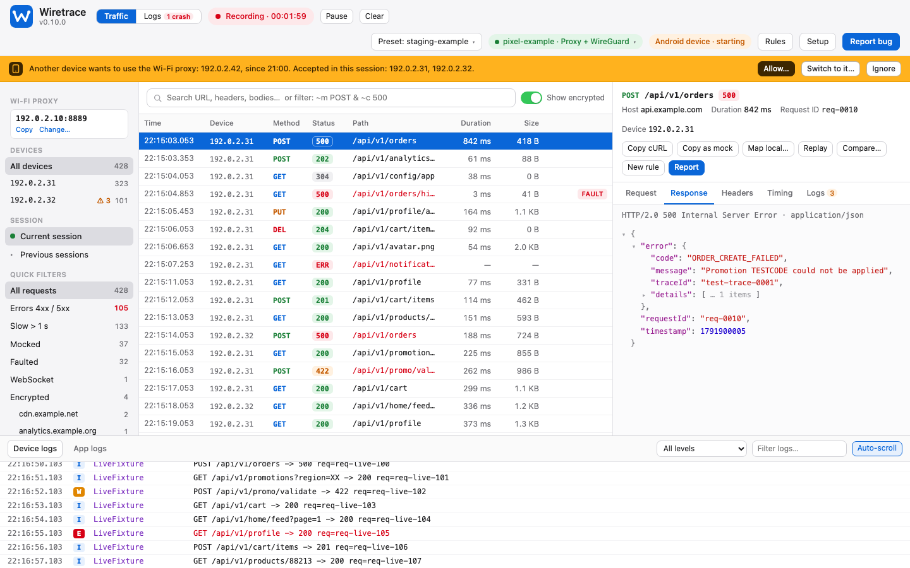
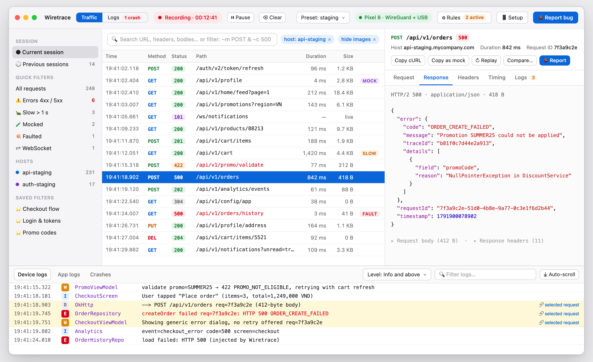
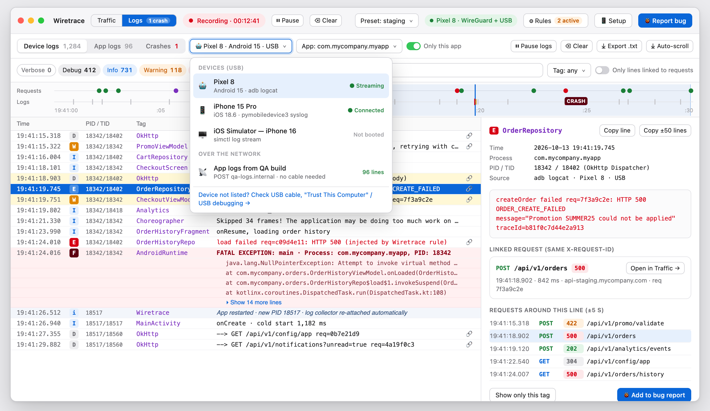
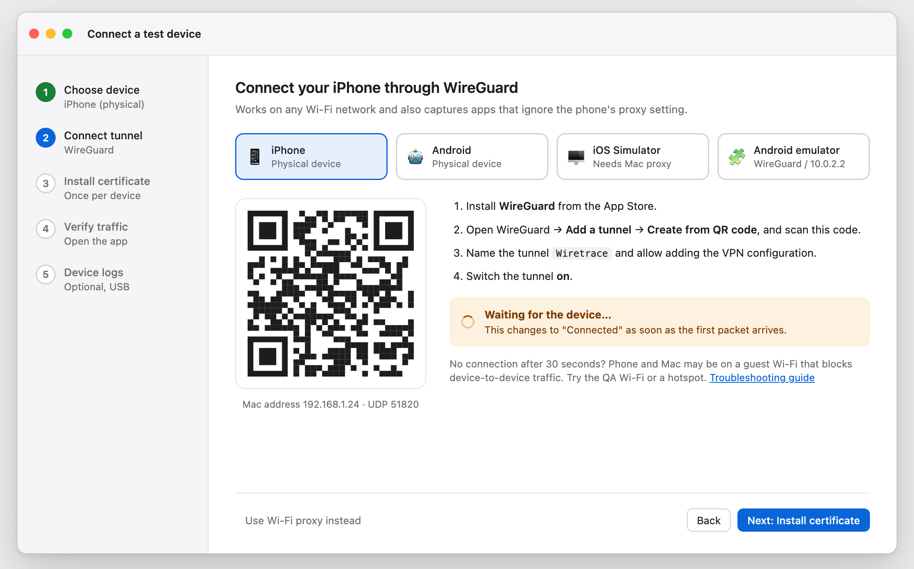
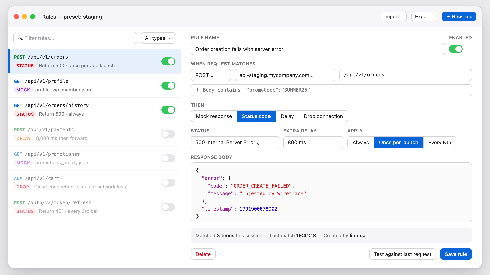
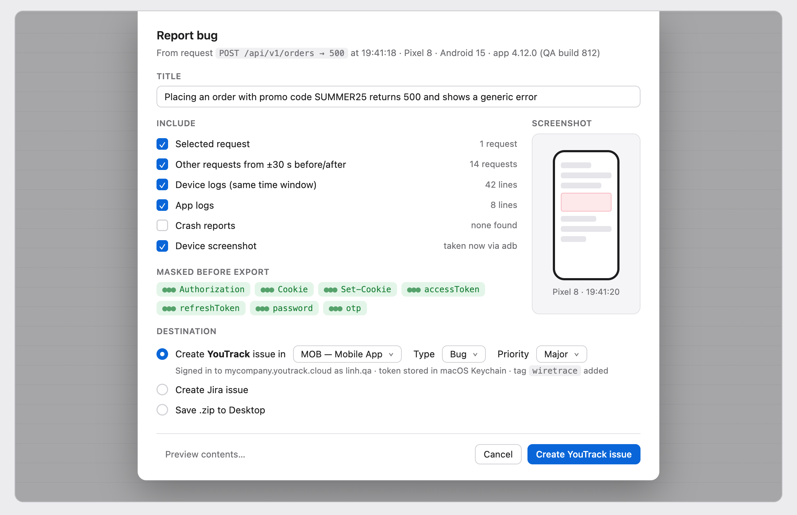
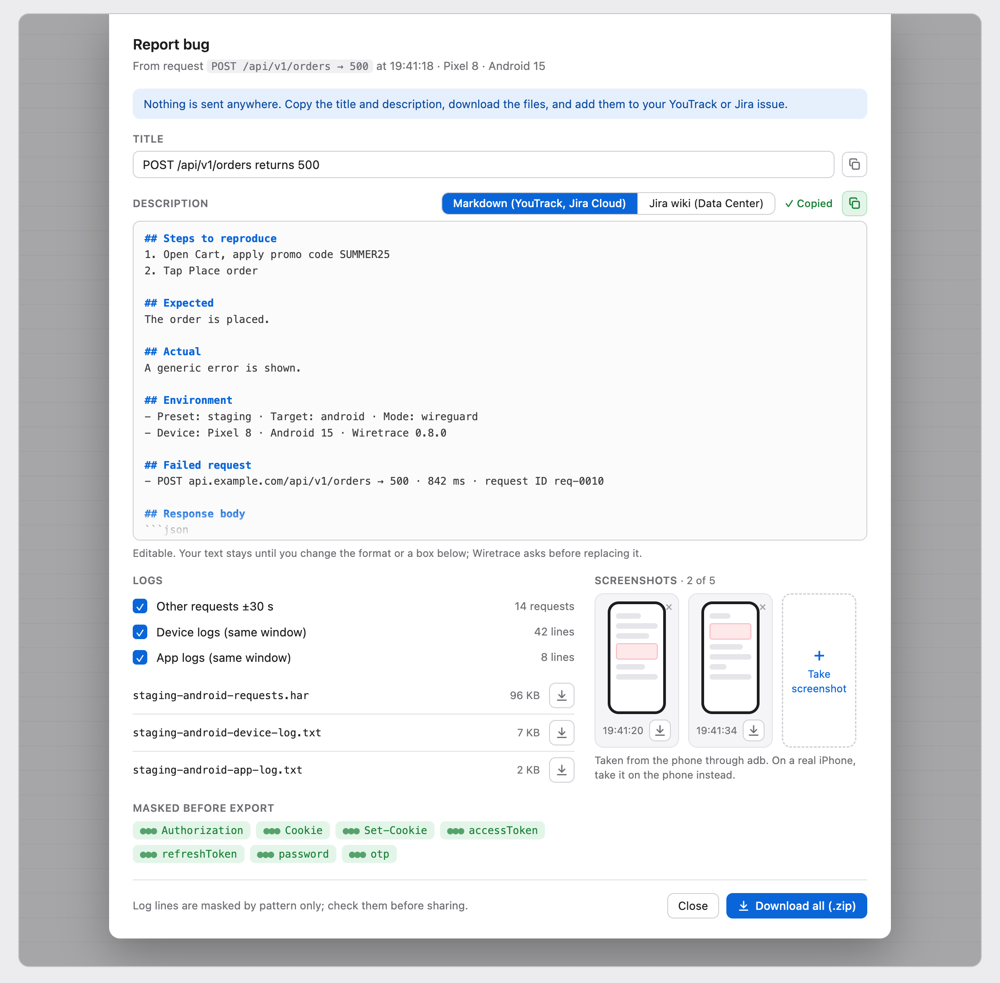
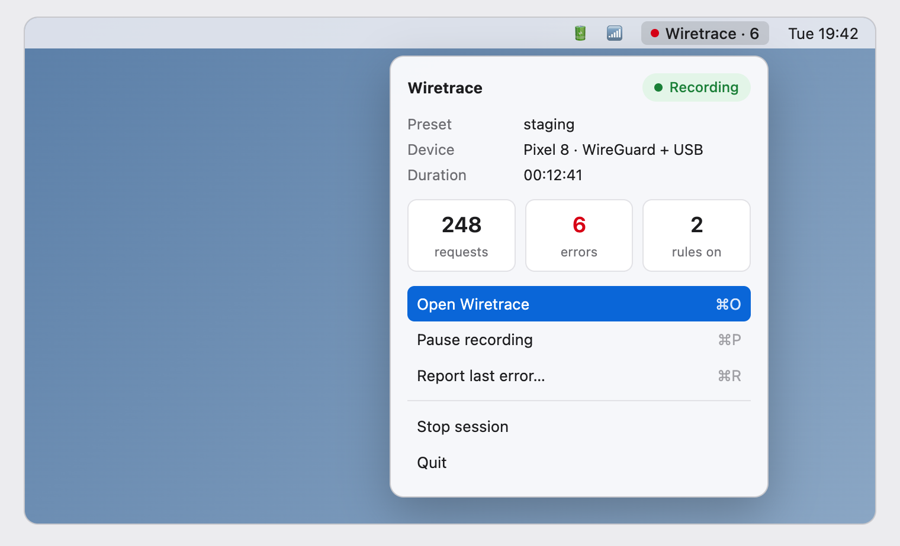

# Wiretrace

A macOS tool that shows and changes the API traffic of iOS and Android apps, next to the
app's logs. Built on [mitmproxy](https://mitmproxy.org). Installs without a Mac admin account.

Current version: **0.8.0**.

## Requirements

- A Mac with macOS, Intel or Apple silicon. A standard (non-admin) account is enough.
  On an Intel Mac, setup installs `cryptography` 48.0.1, the last release with an Intel
  wheel, so its three advisories of 2026 (fixed in 49.0.0 and 50.0.0) stay open there. Apple
  silicon gets the fixed release.
- Internet access to `github.com`, `pypi.org` and `dl.google.com` during setup.
- A test build of the app that trusts user-installed CA certificates and has certificate
  pinning turned off. Store builds cannot be decrypted.
- The WireGuard app on the phone (for WireGuard mode).
- For Android: a phone with USB debugging, or an emulator. For iOS: an iPhone that trusts
  the Mac, or the iOS Simulator (needs Xcode's command line tools).

Use Wiretrace only with apps, devices and accounts you are allowed to test.

## Quick start

Run every command below in **Terminal**, one block at a time. The
[user guide](docs/user-guide.md) explains each step in more detail.

**1. Download.** From the Releases page, download `wiretrace-0.8.0-macos.tar.gz` and
`wiretrace-0.8.0-macos.tar.gz.sha256` into your Downloads folder. Do not double-click them.

**2. Check and unpack** into your home folder. The first line must print `OK`:

```bash
cd ~/Downloads
shasum -a 256 -c wiretrace-0.8.0-macos.tar.gz.sha256
tar -xzf wiretrace-0.8.0-macos.tar.gz -C ~
```

**3. Install** (a few minutes, no password needed, never use `sudo`):

```bash
cd ~/wiretrace
./install                            # add --skip-android if you only test iOS
```

It ends with a setup check. Only `FAIL` lines must be fixed; run `./wiretrace doctor` to
check again. The setup also creates the **Wiretrace app** in `~/Applications`.

**4. Start capturing.** Open **Wiretrace** (the blue **W** icon) from Launchpad or Spotlight.
To keep it in the Dock, right-click its Dock icon → **Options** → **Keep in Dock**.

1. Choose the project: `default`, which comes with Wiretrace, or
   [a preset you created](#your-own-preset-optional).
2. Choose the device: iPhone, Android phone, the iOS Simulator or Android emulator on this
   Mac, or another device with a Wi-Fi proxy. For a Wi-Fi proxy, set the phone's proxy to
   this Mac's IP address, port 8080; the setup wizard shows the steps.

The Wiretrace window opens in your browser, and **● Wiretrace** appears at the top right of
the screen.

<details>
<summary>Or start in Terminal</summary>

Open a **new** Terminal window after the install, then copy the block for your phone.

iPhone:

```bash
cd ~/wiretrace
./wiretrace start --preset default --target ios --ui wiretrace
```

Android phone:

```bash
cd ~/wiretrace
./wiretrace start --preset default --target android --ui wiretrace
```

A phone without the WireGuard app, or one that should use a Wi-Fi proxy instead:

```bash
cd ~/wiretrace
./wiretrace start --preset default --mode proxy --ui wiretrace
```

Then set the phone's Wi-Fi proxy to this Mac's IP address, port 8080. The setup wizard shows
the steps.

With a preset you created, change `default` to its name. For the Android emulator use
`--target android-emu`; for the iOS Simulator use `--target ios-sim --mode proxy --ui wiretrace` (see
[Part 3 of the user guide](docs/user-guide.md#part-3--test-with-wiretrace-every-session)).
Without `--ui wiretrace` you get mitmweb instead. The Terminal also takes the options the app
does not have, such as `--client` or `--no-ui`.

</details>

**5. The first time only, connect the phone:** click *Setup* in the window and follow the
wizard: install the WireGuard app, scan the QR code, turn the tunnel on, then open `http://mitm.it` on the phone
and install the certificate. On an iPhone, also turn on full trust for it in Settings →
General → About → Certificate Trust Settings. Details:
[Part 2 of the user guide](docs/user-guide.md#part-2--prepare-a-test-device-once-per-device).

**6. Test, stop, report.** Test your app, then choose **Stop session** in the
**● Wiretrace** menu (or press Ctrl+C, if you started in Terminal). Wiretrace writes
`flows.har` (secrets masked) into the session folder. For a bug ticket, in Terminal:

```bash
cd ~/wiretrace
./wiretrace report
```

### Your own preset (optional)

A preset tells Wiretrace which hosts to decrypt: only the hosts under its `api_hosts:` are
decrypted. The steps above use the `default` preset (`presets/default.yaml`). In the
Wiretrace window, **Preset → Edit presets…** changes its hosts and **New preset…** creates
another. Or, in Terminal, for another project or environment:

```bash
cd ~/wiretrace
cp presets/example.yaml presets/staging.yaml
open -e presets/staging.yaml
```

In the file that opens, change the lines marked `CHANGE`, then save (Cmd+S):

| Line | Change it to |
|---|---|
| `name: example` | `name: staging`: the file name without `.yaml` |
| the two hosts under `api_hosts:` | your app's API hosts, such as `api-staging.mycompany.com` (no `https://`, no path). Ask the app's developers if you do not know them. |
| `android_package:` | for Android, the app's package name, such as `com.mycompany.myapp` |
| `ios_process:` | for iOS, the app's process name, such as `MyApp` |

Then start with `--preset staging`, or choose `staging` in the Wiretrace app. If
`./wiretrace start` says *name is 'example', but must equal the file name*, the file was not
changed or not saved.

## Design

**The Wiretrace window today** (screenshot of 0.8.0 with the sample data in
[`ui/dev/fixtures/`](ui/dev/fixtures/); every host, token and device in it is fake)



The images below are **design mockups**, not screenshots of the current product. All data
in them is illustrative. They show where Wiretrace is going; the Wiretrace window (preview)
builds screens 1 to 4. Source and notes: [`mockups/`](mockups/README.md).

| Mockup | Status |
|---|---|
| 1. Main window | Built: previous sessions (read-only), saved filters, search in headers and bodies, filter chips, replay, compare. The title bar's preset label is a menu: another preset saves this session and starts a new one, and the phone stays connected; *Edit presets…* and *New preset…* open the preset form (screen 7). Differences: saved filters are kept by the browser, per preset, not on disk; replaying anything but GET, HEAD and OPTIONS asks for confirmation. |
| 2. Device and app logs | Built: device status pill and picker, timeline, crash folding, tag and linked-request filters, line detail. Difference: the picker shows the other log sources and the `--target` to use; it does not switch the collector while Wiretrace runs. |
| 3. Device setup wizard | Built: five steps for iPhone, Android, iOS Simulator and Android emulator, each turning green when Wiretrace sees it work. |
| 4. Mock and fault rules editor | Built: rule list, editor, test against a request, live counters, import and export. Differences: *Once per app launch* is *Once* (until *Re-arm*); rules are saved in `rules/<preset>.json`, not in the preset; the `qa_fault_*` options stay for mitmweb and `--no-ui`. |
| 5. Send a bug report to YouTrack or Jira | Built: form to copy into YouTrack or Jira (screen 5a): title and description in Markdown or Jira wiki, masked HAR and log downloads, Android and Simulator screenshots. Not built: sending directly, signing in to the tracker, iPhone screenshots. |
| 6. Menu-bar app | Built: status item while `./wiretrace start --ui wiretrace` runs (`--no-menu-bar` turns it off). Differences: no *Pause recording* (the window's Pause only freezes its list); *Show last error* instead of *Report last error*; the device line is target, mode and model. |

**1. Main window** (design mockup)



**2. Device and app logs** (design mockup)



**3. Device setup wizard** (design mockup)



**4. Mock and fault rules editor** (design mockup)



**5. Bug report to YouTrack or Jira** (design mockup; sending directly is not built yet)



**5a. Bug report form, copy and download** (design mockup)



**6. Menu-bar app** (design mockup)



## Features

- **Setup check.** `./wiretrace doctor` checks Python, mitmproxy, the ports, the macOS
  firewall, `adb` and connected devices, and the CA certificate, and says what to fix.
- **Capture.** `./wiretrace start` runs mitmproxy in WireGuard mode (UDP 51820, the
  default) or as a Wi-Fi proxy (`--mode proxy`, TCP 8080). `--target` is `android`, `ios`,
  `android-emu`, `ios-sim` or `device`. Each session is saved in its own folder under
  `sessions/`, as it happens.
- **Presets.** One YAML file per project and environment. Only the listed API hosts are
  decrypted; all other traffic passes through untouched. A preset also sets the starting
  filter, the mocks folder, the request ID header, the app to collect logs from, and extra
  names to mask.
- **Mocks from files.** A file `mocks/<preset>/<METHOD>/<path>.json` answers that request
  instead of the backend. Changes apply to the next request, without a restart.
- **Rules.** Per request: answer with a mock or a status code, wait a number of
  milliseconds, or drop the connection, always, once, or every Nth call. Edited in the
  Wiretrace window's *Rules* view and saved in `rules/<preset>.json`. The older
  `qa_fault_*` options still work in mitmweb.
- **Device logs.** The app's own process log, collected next to the traffic: `adb logcat`
  for Android devices and emulators, `pymobiledevice3` for iPhones, `simctl` for the iOS
  Simulator. The log follows the app across restarts and reconnects.
- **In-app logs.** A test build can `POST` its own log lines to `https://qa-logs.internal/log`;
  Wiretrace answers that name itself and stores the lines in the session. Nothing leaves the Mac.
- **Request IDs.** The `X-Request-ID` header (or another one set in the preset) links a
  request to the log lines that carry the same ID.
- **Masked HAR.** When a session stops, Wiretrace writes `flows.har` with passwords, tokens
  and cookies replaced by `***`.
- **Bug report zip.** `./wiretrace report` packs a session into one zip: a summary with the
  failed requests, the masked HAR, and the masked logs.
- **Bug report form.** In the Wiretrace window, *Report bug* fills in a title and a
  description (Markdown for YouTrack and Jira Cloud, or Jira wiki for Jira Data Center) for the
  failed request, offers the masked HAR and logs around it as downloads, and takes Android or
  Simulator screenshots. You copy and download; nothing is sent anywhere.
- **Wiretrace window (preview).** `--ui wiretrace` opens Wiretrace's own window, with traffic
  and logs on one screen, a log timeline with the device's status, earlier sessions, search in
  headers and bodies, replay and compare, the setup wizard and the Rules view. It is only
  reachable from the same Mac, with a new
  token at every start. While it runs, the menu bar shows that Wiretrace is recording and how
  many requests failed; from there you can open the window, jump to the last error, or stop
  the session. `--no-menu-bar` leaves that item out. mitmweb stays the default, so without
  `--ui wiretrace` you get mitmweb and no Rules view; `--no-ui` runs in the Terminal only.
- **Wiretrace app.** The setup builds `~/Applications/Wiretrace.app` on your Mac, with the
  Wiretrace icon. Open it from Launchpad, Spotlight or the Dock, pick a project and a device,
  and the Wiretrace window opens; the menu bar item is how you stop that session.
- **Release files.** `make tarball` (or `make release`, which also makes the `.dmg`) runs
  `scripts/build-release.sh`, which builds a `.tar.gz` and a `.dmg`, each with a
  SHA-256 checksum, from one commit.

Masking has limits (for example, bodies that are neither JSON nor forms are not changed).
Read [what is and is not masked](docs/user-guide.md#step-5--export-for-the-bug-ticket)
before you share a report.

## Documents

- [`docs/user-guide.md`](docs/user-guide.md): install, device setup, and daily use, step by step
- [`docs/install-without-admin.md`](docs/install-without-admin.md): what needs admin rights and what does not
- [`docs/diagrams.md`](docs/diagrams.md): workflows and diagrams
- [`PLAN.md`](PLAN.md): goals, architecture, phases
- [`docs/specs/`](docs/specs/): the spec for each piece of work

## Development

```bash
uv pip install --python .venv/bin/python -r requirements-dev.txt
.venv/bin/python -m pytest
```

Release files (`.tar.gz` and `.dmg`, with checksums) are built from a commit into `dist/`:
`make tarball` (the `.tar.gz` only), `make release` (both), with `COMMIT=<ref>` for another
commit than `HEAD`. They run `scripts/build-release.sh [--tar-only] [<commit>]`. Commit first,
including `ui/dist/` after `make ui`: uncommitted changes are never in a release.

The app's icon is `app/Wiretrace.icns`, built from `app/icon.svg` with `make icon` (needs
`rsvg-convert`) and committed, so testers' Macs never build it.

## License

Wiretrace is licensed under the [Apache License 2.0](LICENSE). See [`LICENSE`](LICENSE) and
[`NOTICE`](NOTICE).

Third-party software:

- [mitmproxy](https://mitmproxy.org) is MIT-licensed.
- [pymobiledevice3](https://github.com/doronz88/pymobiledevice3) is licensed under
  GPL-3.0-or-later. `scripts/setup-mac.sh` installs it from PyPI, and Wiretrace runs it as a
  separate command. Wiretrace does not import it, and the release archive does not include it.
