# Wiretrace — Workflows and Diagrams

Companion to [`PLAN.md`](../PLAN.md). All diagrams are Mermaid and render in GitLab, GitHub, and Cursor's markdown preview.

Contents:

1. [QA daily testing workflow](#1-qa-daily-testing-workflow)
2. [One-time setup workflow](#2-one-time-setup-workflow)
3. [Choosing how to connect a device](#3-choosing-how-to-connect-a-device)
4. [Troubleshooting flow](#4-troubleshooting-flow)
5. [Sequence: intercepting an API call](#5-sequence-intercepting-an-api-call)
6. [Sequence: mock and fault injection](#6-sequence-mock-and-fault-injection)
7. [Sequence: collecting logs and linking them to requests](#7-sequence-collecting-logs-and-linking-them-to-requests)
8. [Sequence: creating a bug report](#8-sequence-creating-a-bug-report)
9. [Component diagram](#9-component-diagram)
10. [Deployment diagram](#10-deployment-diagram)
11. [Network ports and connections](#11-network-ports-and-connections)
12. [Session lifecycle](#12-session-lifecycle)
13. [Session data model](#13-session-data-model)
14. [Delivery timeline](#14-delivery-timeline)

---

## 1. QA daily testing workflow

What a QA engineer does during a normal test task.

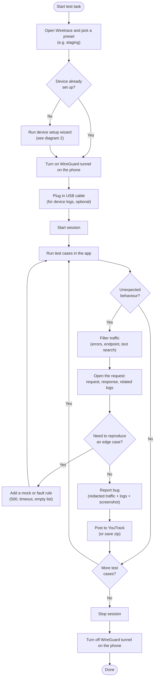

---

## 2. One-time setup workflow

Done once per Mac and once per test device.

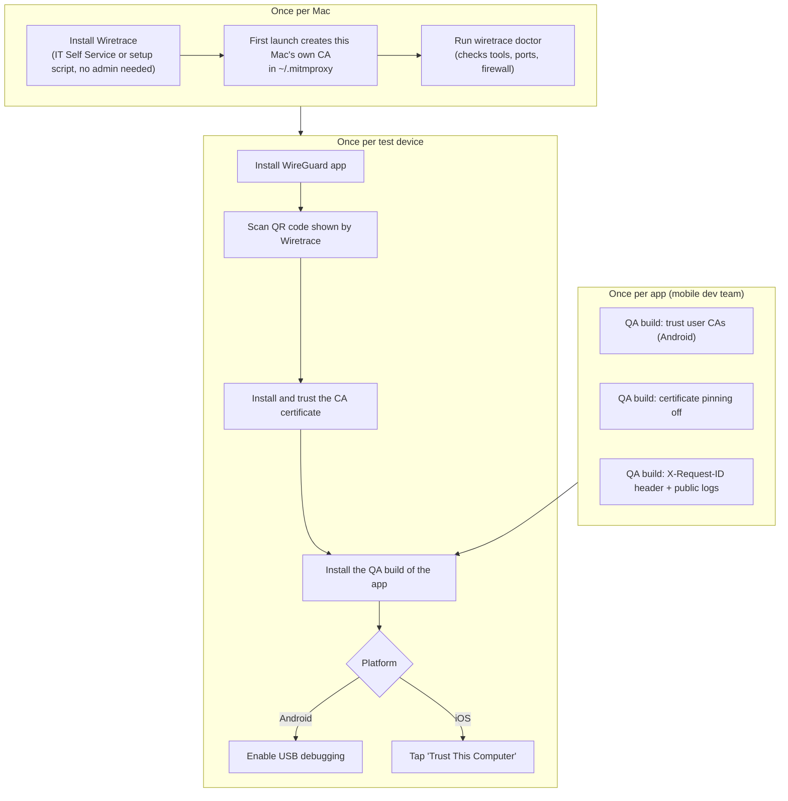

---

## 3. Choosing how to connect a device

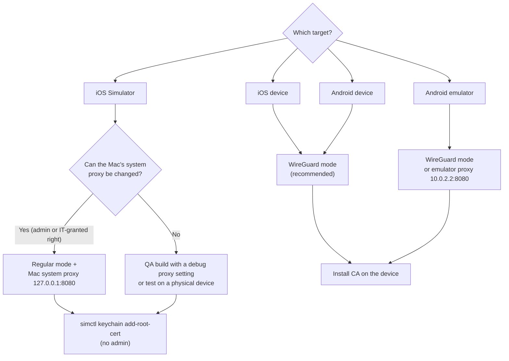

WireGuard mode is the default because it works the same on every Wi-Fi network and also captures apps that ignore the phone's proxy setting (Flutter, some React Native libraries).

---

## 4. Troubleshooting flow

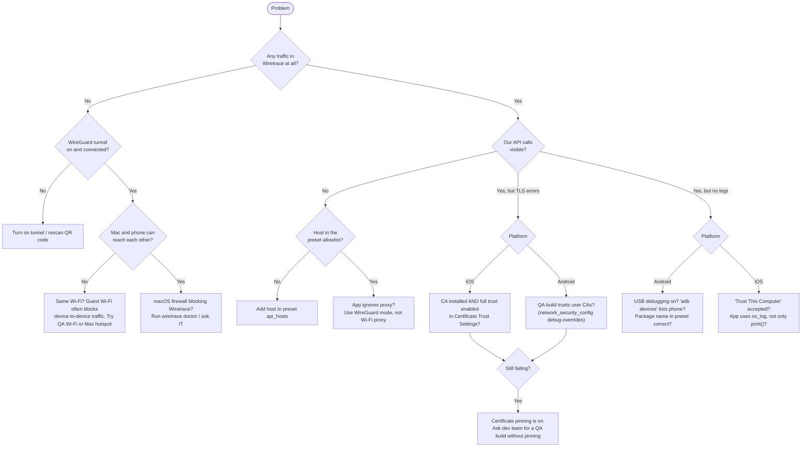

---

## 5. Sequence: intercepting an API call

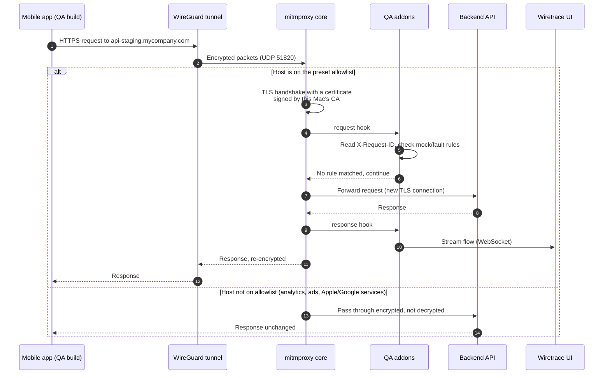

---

## 6. Sequence: mock and fault injection

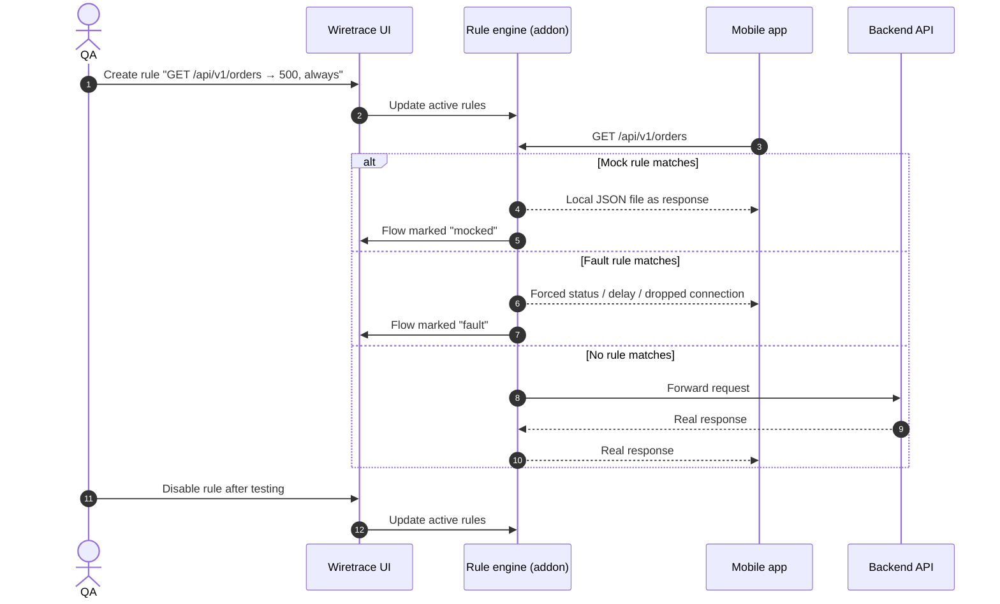

---

## 7. Sequence: collecting logs and linking them to requests

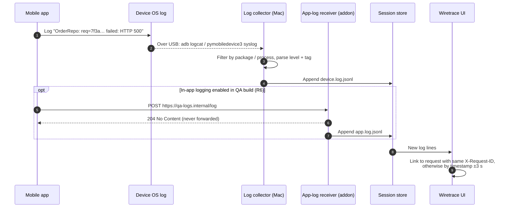

---

## 8. Sequence: creating a bug report

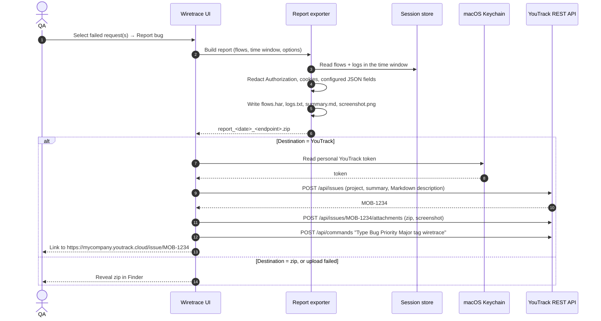

The same flow is available from the CLI in Phase 1: `./wiretrace report <session> --youtrack`.

---

## 9. Component diagram

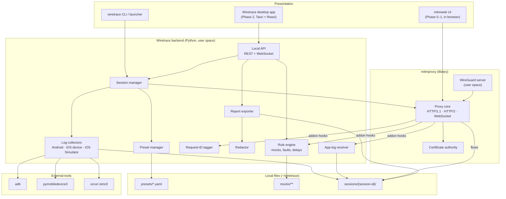

| Component | Responsibility |
|---|---|
| Session manager | Starts/stops proxy and collectors, creates the session folder and `meta.json` |
| Preset manager | Loads `presets/*.yaml`, builds `--allow-hosts` list and default filter |
| Rule engine | Mock responses, forced status codes, delays, dropped connections |
| Request-ID tagger | Reads `X-Request-ID`, stores it on the flow for log matching |
| App-log receiver | Accepts `POST qa-logs.internal/log`, stores it, answers `204` |
| Log collectors | Wrap `adb`, `pymobiledevice3`, `simctl`; write JSON lines |
| Redactor | Masks sensitive headers and JSON fields in exports |
| Report exporter | Builds HAR, logs, summary, zip; posts the issue to YouTrack (token from macOS Keychain) |

---

## 10. Deployment diagram

Everything Wiretrace needs runs in the user's home folder, so it works on standard (non-admin) accounts. Items in the "IT-managed" box are optional and only needed for the features listed. See [`install-without-admin.md`](install-without-admin.md).

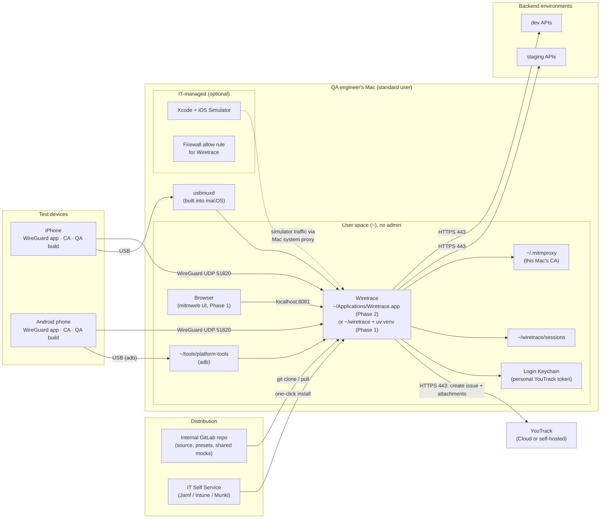

### Deployment options compared

| Option | Phase | Admin needed? | Updates | Best for |
|---|---|---|---|---|
| Setup script + `uv` venv in `~/wiretrace` | 1 | No | `git pull` + `uv pip install -r requirements.txt` | Pilot, technical QA |
| Signed `.app` copied to `~/Applications` | 2 | No | Built-in updater | Small teams without MDM |
| IT Self Service package | 1 or 2 | No (IT installs) | Pushed by IT | Company-managed Macs (recommended) |

---

## 11. Network ports and connections

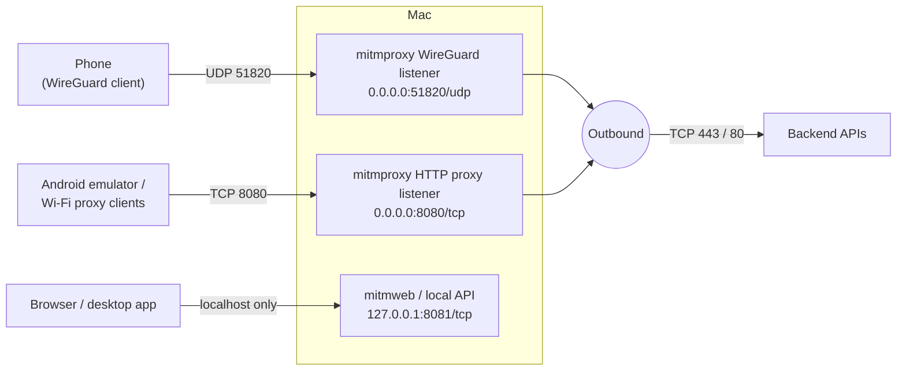

| Port | Protocol | Bound to | Purpose | Admin needed? |
|---|---|---|---|---|
| 51820 | UDP | all interfaces | WireGuard from phones | No (port > 1024) |
| 8080 | TCP | all interfaces | Regular HTTP proxy (emulator, simulator, fallback) | No |
| 8081 | TCP | `127.0.0.1` only | mitmweb UI / local API | No |

The UI port is bound to localhost so other people on the Wi-Fi cannot see captured traffic.

---

## 12. Session lifecycle

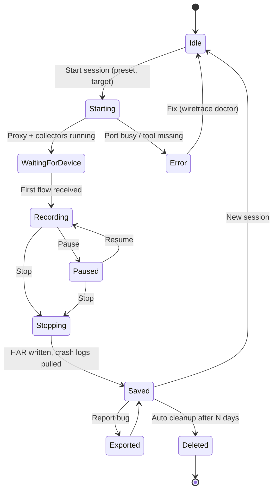

---

## 13. Session data model

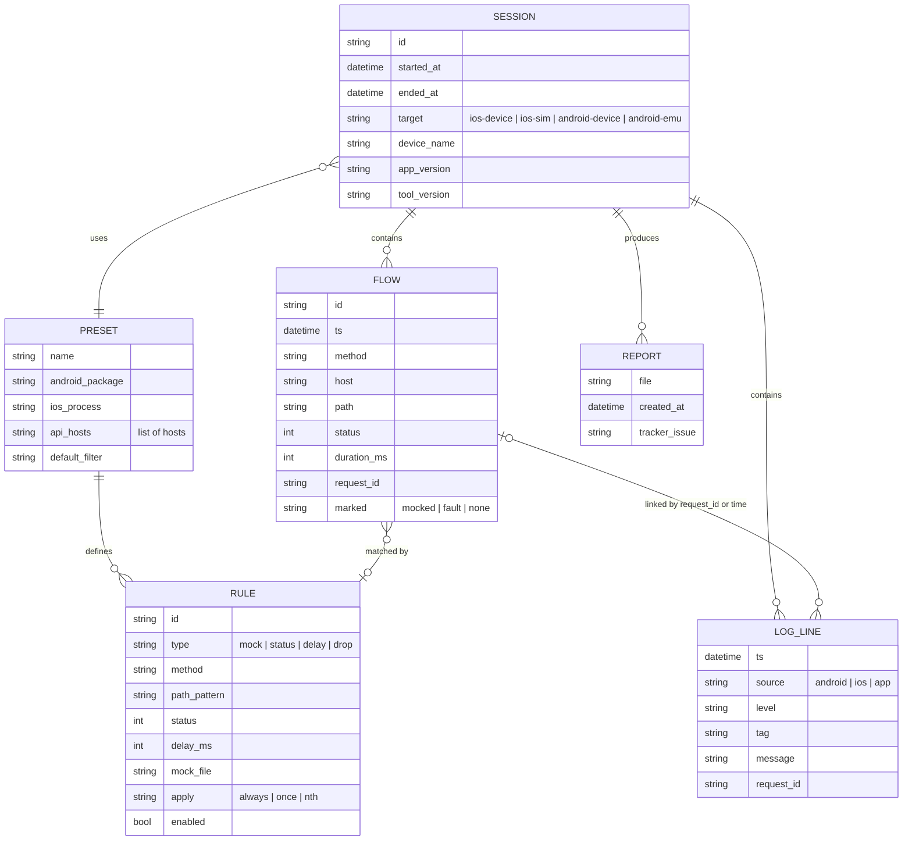

---

## 14. Delivery timeline

Durations are working days and approximate (1 developer).

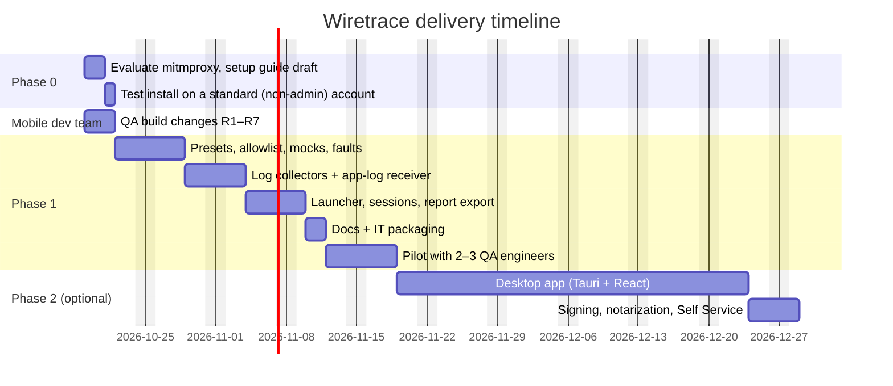
