# Wiretrace — UI mockups

Mockups for the Phase 2 desktop app described in [`PLAN.md`](../PLAN.md) (feature IDs U1–U10). All data shown is illustrative.

- Source: [`wiretrace-mockup.html`](wiretrace-mockup.html). Open it in any browser (`open mockups/wiretrace-mockup.html`); it is a single static file with no dependencies. Buttons are not clickable.
- Images: [`screens/`](screens/), rendered at 2× from the HTML.

To regenerate the images after editing the HTML:

```bash
"/Applications/Google Chrome.app/Contents/MacOS/Google Chrome" --headless=new --hide-scrollbars \
  --force-device-scale-factor=2 --window-size=1480,4950 \
  --screenshot=/tmp/full.png "file://$PWD/mockups/wiretrace-mockup.html"
# then crop each screen: its .window box plus 20 px left/right and 16 px top/bottom, at 2x, e.g.:
sips --cropOffset 380 40 -c 1712 2800 /tmp/full.png --out mockups/screens/01-main-window.png
```

---

## 1. Main window — traffic, details, and logs (U3–U7)


| Area | What it does |
|---|---|
| Title bar | **Traffic / Logs** view switch (with crash count), recording state, pause/clear, active preset, device connection, rules (with active count), device setup, **Report bug**. |
| Left sidebar | Current and previous sessions; quick filters with live counts (errors, slow, mocked, faulted, WebSocket); hosts from the preset; saved filters. |
| Traffic list | One row per request: time, method, status, path, duration, size. Errors are red; mocked, faulted, and slow requests get badges. |
| Detail panel | Selected request with request ID; **Copy cURL**, **Copy as mock**, **Replay**, **Compare**, **Report**; tabs for request, response (pretty JSON), headers, timing, and linked logs. |
| Log strip | Quick view of recent logs; lines with the same `X-Request-ID` as the selected request are highlighted. |

## 2. Device & app logs (U6, U7)


The full log view, opened with **Logs** in the title bar.

| Area | What it does |
|---|---|
| Source tabs | **Device logs** (system log from the phone over USB), **App logs** (sent by the QA build to `qa-logs.internal`, no cable needed), **Crashes**. |
| Device picker (shown open) | Choose the log source: Android device (`adb logcat`), iPhone (`pymobiledevice3 syslog`), iOS Simulator (`simctl log stream`), or app logs over the network, with live connection status. |
| App filter | Limits logs to the app under test (package / process name from the preset). The collector re-attaches automatically when the app restarts or crashes (see the "App restarted · new PID" line). |
| Level chips and search | Toggle Verbose/Debug/Info/Warning/Error/Fatal with counts; text or regex search; tag filter; "only lines linked to requests". |
| Timeline | Requests (dots coloured by status) and log lines (ticks; errors red, crash marked) on one time axis. The shaded area is the part shown in the list; the blue line is the selected log line. |
| Log list | Time, level, PID/TID, tag, message. A 🔗 icon means the line contains a request ID that matches captured traffic. Crashes show the stack trace inline. |
| Detail panel | Full message and metadata, the **linked request** (open it in Traffic), requests around the same time, **Copy ±50 lines**, **Add to bug report**. |

## 3. Device setup wizard (U2)


Five steps: choose the device type, connect the WireGuard tunnel by scanning a QR code, install the CA certificate, verify that traffic arrives, and optionally connect USB for logs. The wizard waits for the first packet and shows troubleshooting hints if nothing arrives. "Use Wi-Fi proxy instead" is the fallback path.

## 4. Mock & fault rules (U8)


Left: rules for the current preset, each with an on/off toggle and a summary. Right: the editor.

- **Match** by method, host, path pattern, and optionally body content.
- **Action**: mock response, status code, delay, or drop connection.
- **Apply**: always, once per app launch, or every Nth call. This covers cases like "token refresh fails every 3rd time".
- Shows how often the rule matched in this session. **Test against last request** previews the result without using the app.

## 5. Bug report → YouTrack (U10)


Opened from a failed request or log line. It pre-fills the title and context (device, OS, app build) and includes surrounding requests, device and app logs from the same time window, and a device screenshot. Sensitive headers and fields are masked before anything is uploaded.

The default destination is **YouTrack**: pick the project, type, and priority, and the tool creates the issue, attaches the redacted report and screenshot, adds the `wiretrace` tag, and shows the issue link. The QA engineer's personal YouTrack token is stored in the macOS Keychain. Jira and "Save .zip" are alternative destinations. Details: `PLAN.md` section 9.8.

## 5a. Bug report form — copy and download (U10, first version)


The first version of screen 5 ([spec 012](../docs/specs/012-bug-report-form.md)), without the tracker integration. Wiretrace sends nothing anywhere.

| Area | What it does |
|---|---|
| Title | Pre-filled from the failed request, editable; the copy icon copies it. |
| Description | Pre-filled with steps, expected, actual, environment, the failed request, the masked response body and linked log lines; editable. **Markdown** (YouTrack, Jira Cloud) or **Jira wiki** (Data Center) changes what the copy icon copies. |
| Logs | Boxes for the requests and log lines within ±30 s; each file (masked HAR, device log, app log) has a download icon. |
| Screenshots | **Take screenshot** through `adb` (Android phone or emulator) or `simctl` (iOS Simulator), up to 5, each with a download icon. On a real iPhone, the tester takes it on the phone. |
| Footer | **Download all (.zip)**: the files above plus `summary.md`. |

## 6. Menu-bar status (U1)


Shows recording state and error count in the macOS menu bar, with shortcuts to open the app, pause, report the last error, or stop the session.

## 7. Presets — switch, edit, or add

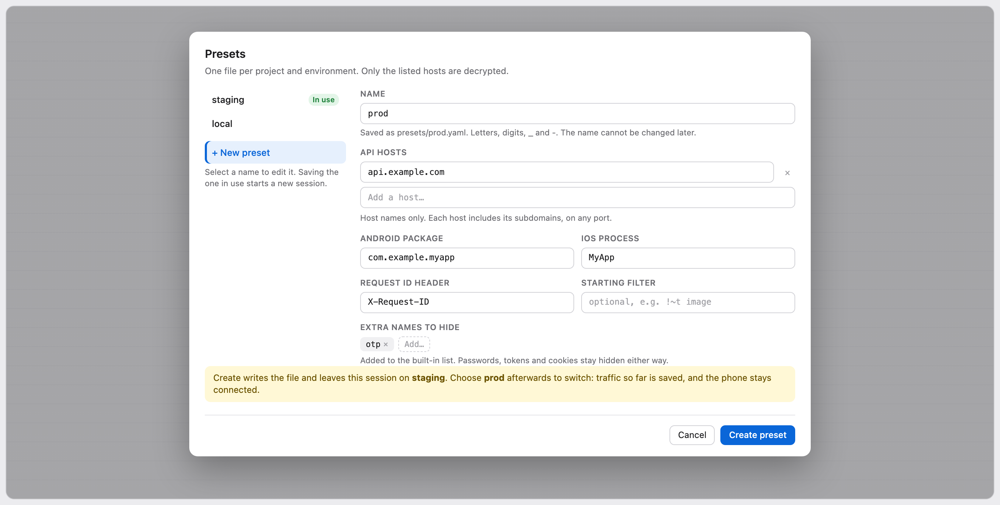

Opened from **Preset** in the title bar (*Edit presets…*, *New preset…*). Built (spec 013, extension A). Differences: the extra names to hide are two lists, headers and fields, as in the file; `example` opens read-only; choosing another preset stays in the menu. Source: the last screen in [`wiretrace-mockup.html`](wiretrace-mockup.html).

| Action | What it does |
|---|---|
| Select a preset | Fills the form with that file. |
| New preset | A blank form. **Create preset** writes `presets/<name>.yaml` and leaves the current session running. |
| Save the preset in use | Writes the file, saves this session, and starts a new one with the same target and mode. The phone stays connected. |
| Choose another preset | Same restart, using that file. |

The name of an existing preset stays fixed. The form edits hosts, the Android package, the iOS process, the request-ID header, the starting filter, and extra names to hide.

## 10. More devices, port 8889, encrypted hosts, breakpoints, rewrite, map local, map remote

Design for [spec 022](../docs/specs/022-more-devices-port-encrypted-hosts-breakpoints.md). Source: [`proxy-and-breakpoints-mockup.html`](proxy-and-breakpoints-mockup.html), styled from `ui/src/styles.css`; purple dashed outlines mark what is new. Designed at 1440 px. Each screen renders on its own:

```bash
C="/Applications/Google Chrome.app/Contents/MacOS/Google Chrome"
r() { "$C" --headless=new --user-data-dir=/tmp/wt-chrome --hide-scrollbars --force-device-scale-factor=2 \
  --window-size=$2 --screenshot=mockups/screens/$3.png "file://$PWD/mockups/proxy-and-breakpoints-mockup.html?only=$1"; }
r s10a 1480,1000 10a-devices-on-one-port; r s10b 1480,1000 10b-allow-device; r s10c 1480,1000 10c-remove-device
r s10d 1480,1000 10d-encrypted-hosts; r s10e 1480,1000 10e-decrypt-host; r s10f 1480,800 10f-setup-port
r s10g 1480,800 10g-change-port; r s10h 1480,1000 10h-breakpoint-rule; r s10i 1480,1000 10i-paused-request
r s10j 1480,1000 10j-paused-response; r s10k 1480,1000 10k-rewrite-rule; r s10l 1480,1000 10l-map-remote-rule
r s10m 1480,1000 10m-mapped-and-rewritten; r s10n 1480,1000 10n-map-local-menu; r s10o 1480,1000 10o-map-local-dialog
```

### 10a. Several phones on one port

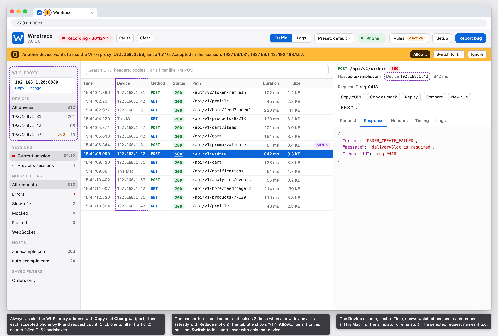

| Area | What it does |
|---|---|
| Sidebar, Wi-Fi proxy | Always visible: the address phones set as their proxy (`192.168.1.20:8889`), **Copy**, **Change…** (the port). |
| Sidebar, Devices | Each accepted phone by IP address, with its request count; ⚠ counts failed TLS handshakes (it does not trust the certificate yet). Clicking one filters Traffic. |
| Device column | Next to Time: which phone sent each request; "This Mac" for the simulator or emulator. |
| Banner | Spec 021's banner gains **Allow…**: the device joins this session without a restart. **Switch to it…** still starts over with only that device. It is now solid amber with a phone icon, pulses 3 times when a new device asks (no pulse with Reduce motion), and the tab title shows the waiting count, "(1) Wiretrace". |

### 10b. Allow a device

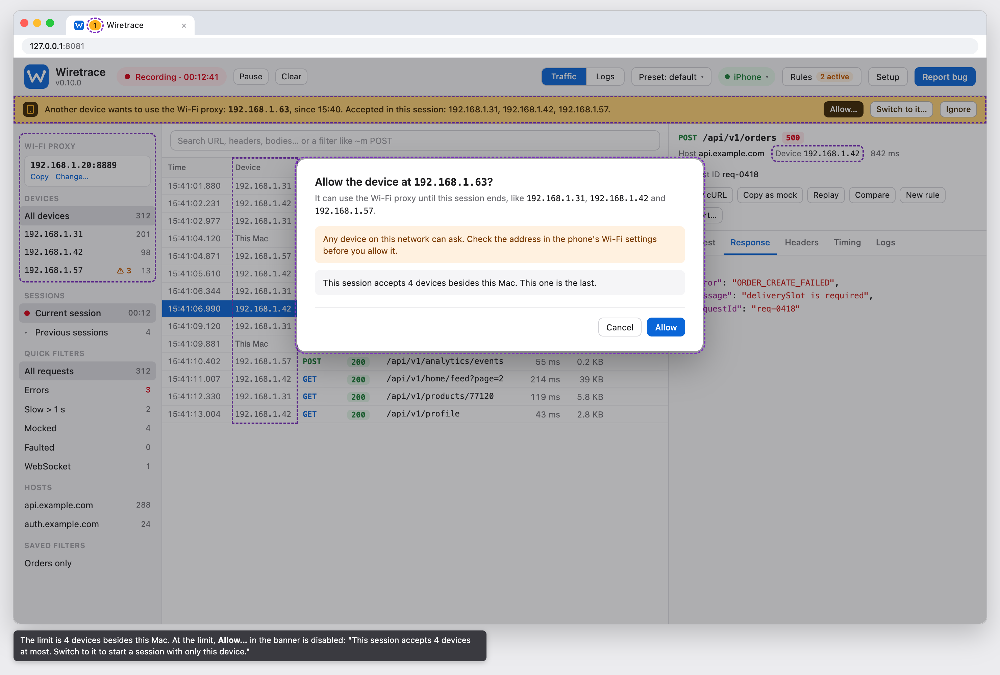

The tester checks the address on the phone first. At most 4 devices besides this Mac; at the limit, **Allow…** is disabled.

### 10c. Remove a device

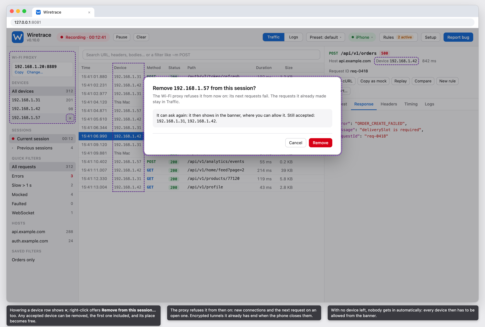

**×** on a device row (or right-click). The proxy refuses it from then on; its requests already listed stay. It can ask again through the banner. With no device left, every device has to be allowed.

### 10d. Encrypted connections

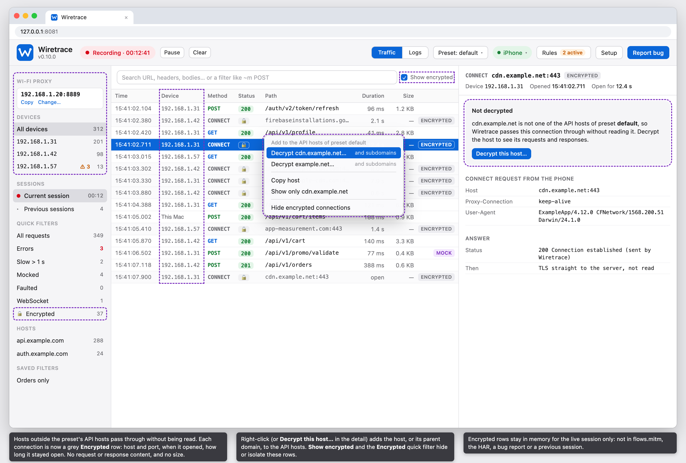

Hosts outside the preset's API hosts show as grey **Encrypted** rows (host, port, when it opened, how long), in memory for the live session only. Right-click or **Decrypt this host…** adds the host or its parent domain to the API hosts. **Show encrypted** and the **Encrypted** quick filter hide or isolate them.

### 10e. Decrypt a host

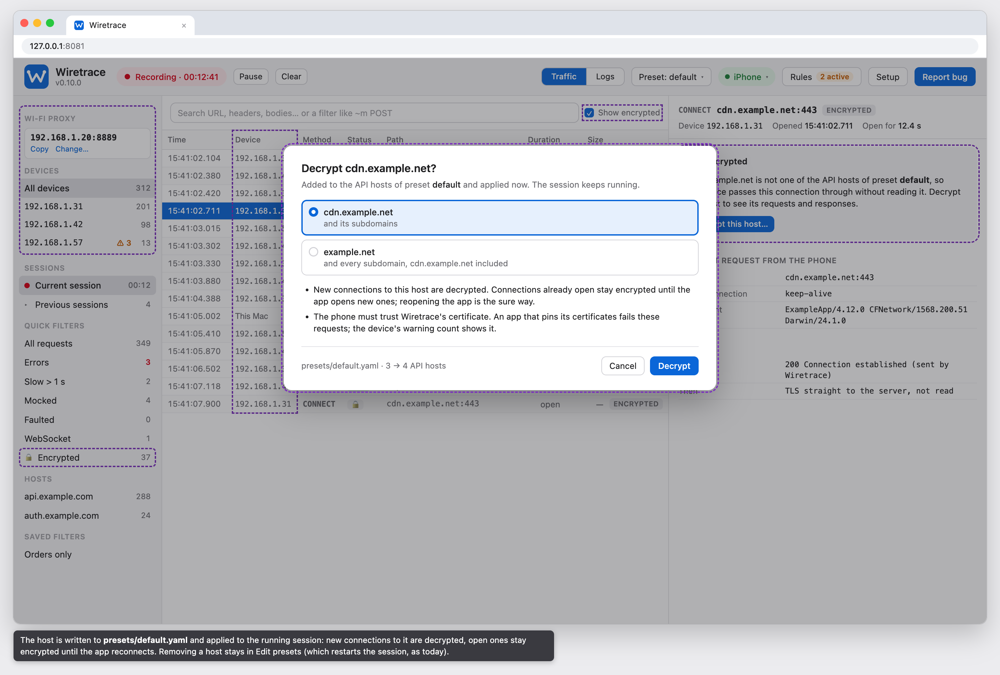

Written to the preset and applied without a restart; open connections stay encrypted until the app reconnects.

### 10f–10g. Port 8889, and changing it

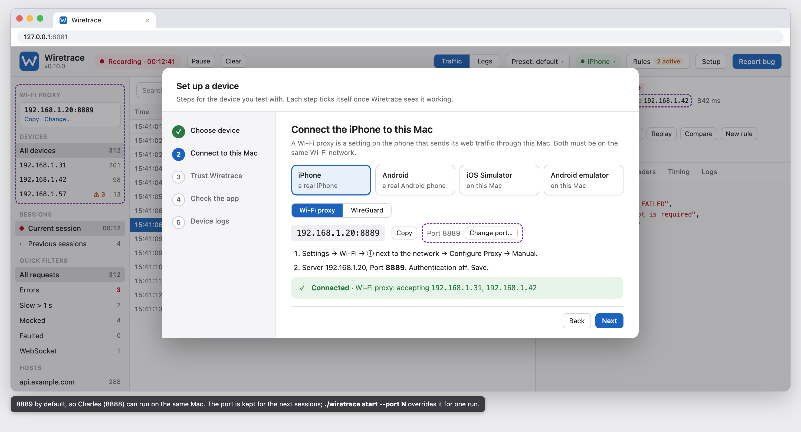

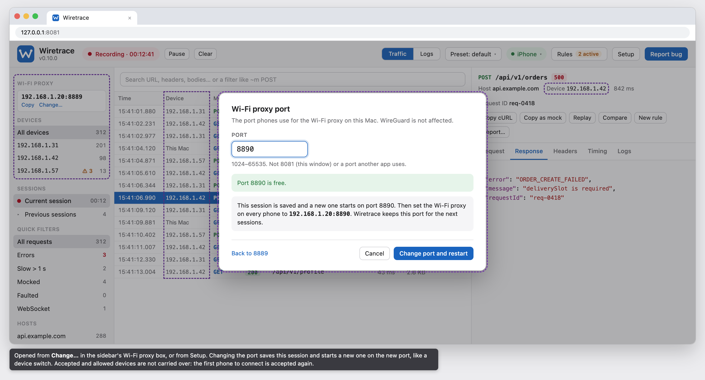

8889 by default, so Charles (8888) can run on the same Mac. Changing the port saves this session and starts a new one on the new port; Wiretrace keeps it for the next sessions.

### 10h–10j. Breakpoints

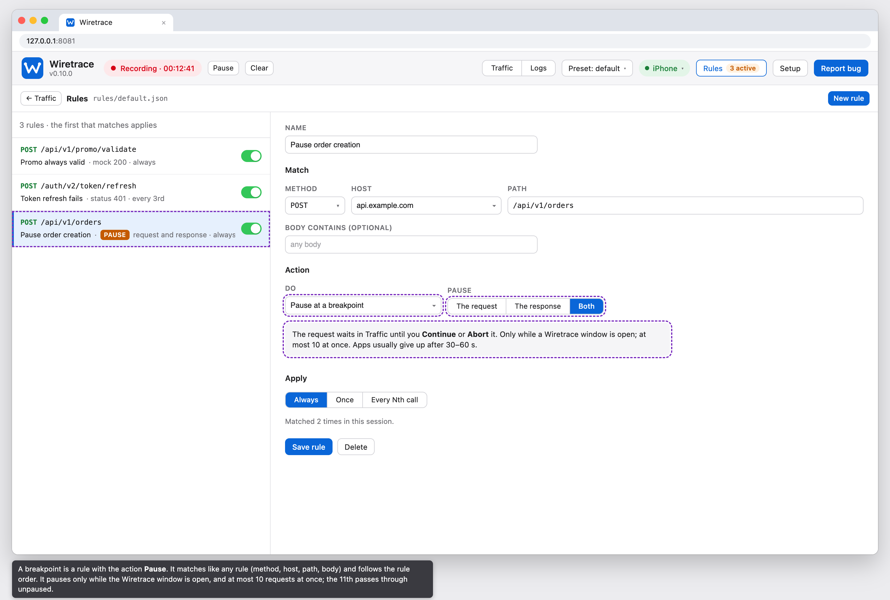

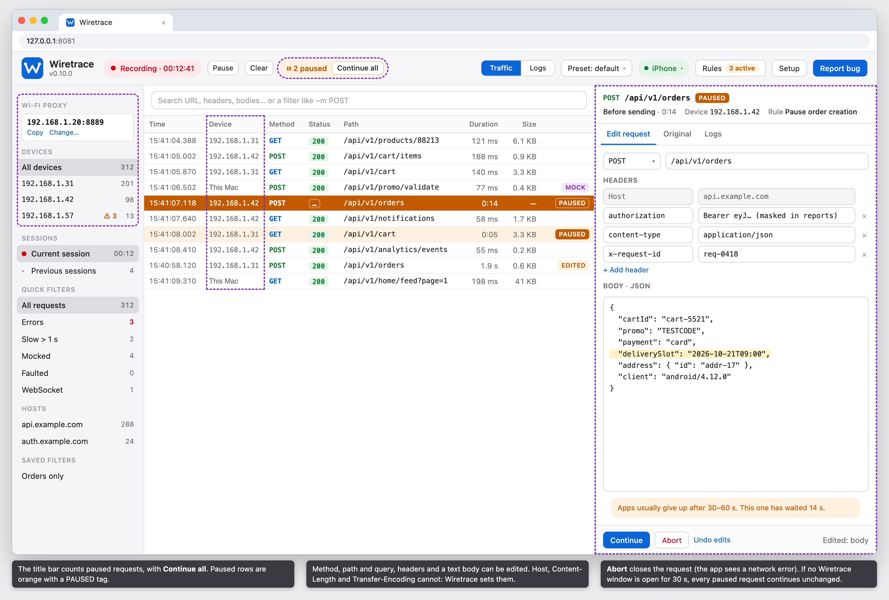

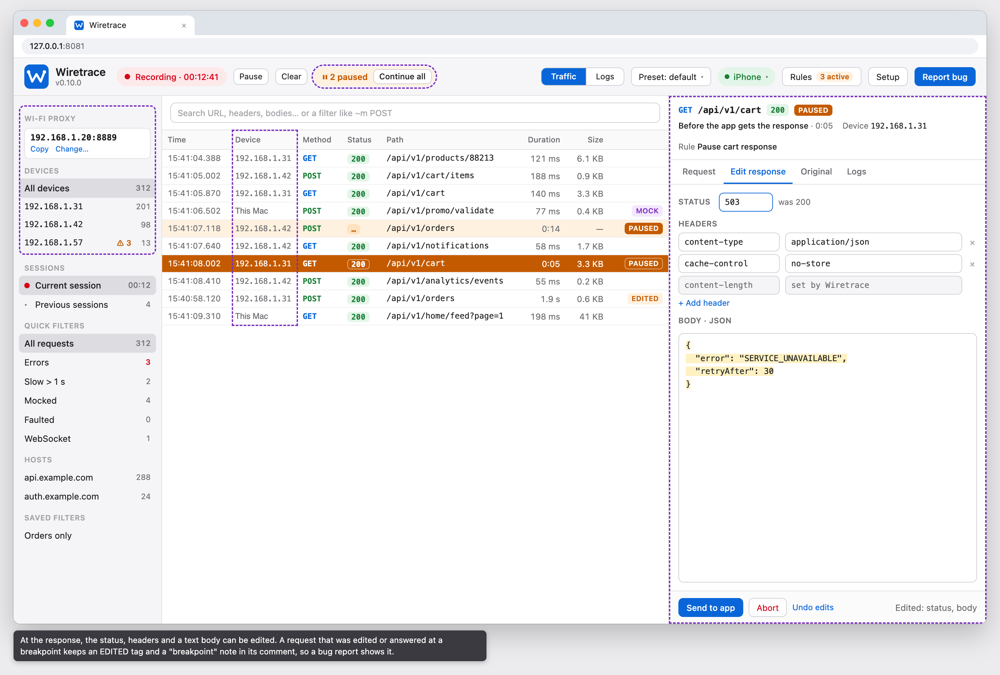

A rule with the action **Pause** stops a request before it is sent, its response before the app gets it, or both. The paused request is edited in the detail panel, then **Continue** or **Abort**; the title bar counts paused requests and has **Continue all**. Only while a window is open, at most 10 at once.

### 10k–10m. Rewrite and Map remote

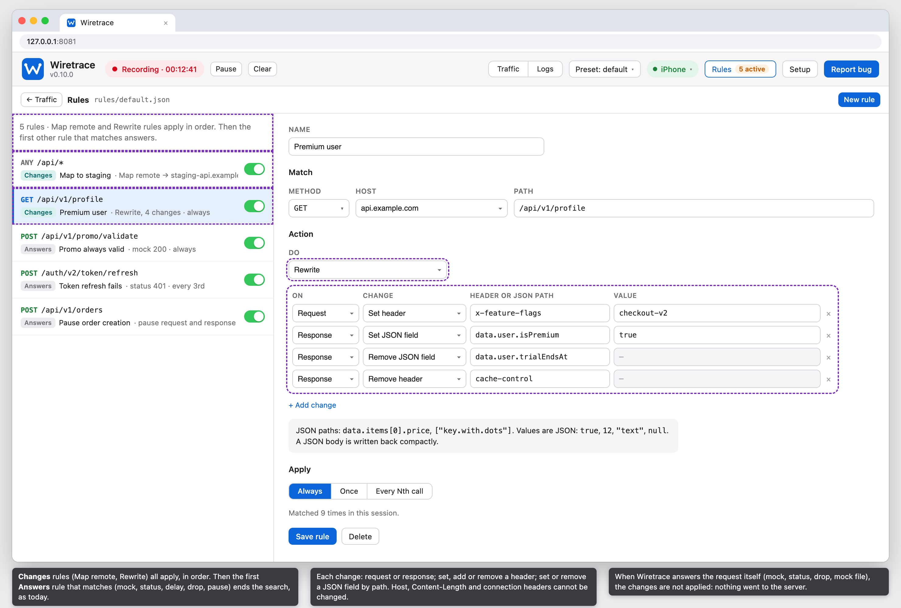

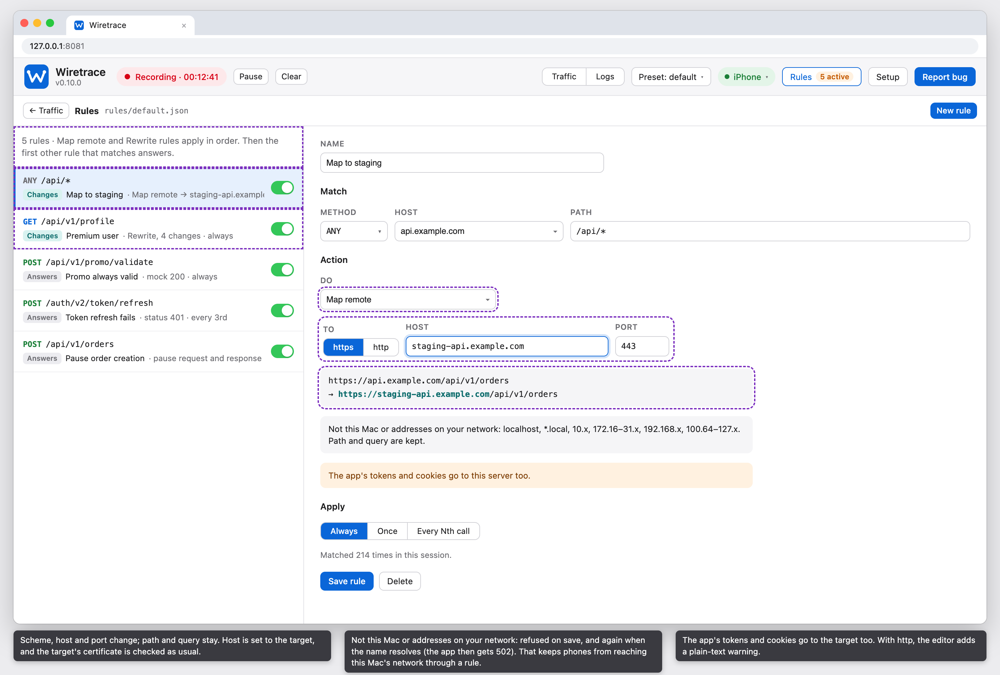

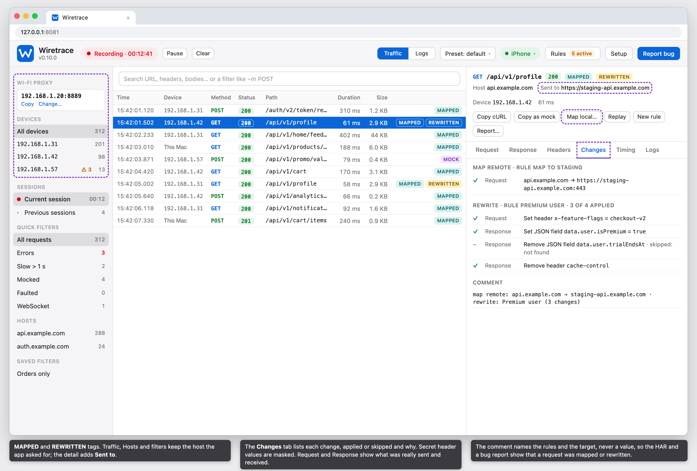

Two new actions that **change** a request instead of answering it. **Rewrite** sets, adds or removes headers and sets or removes JSON fields, on the request or the response. **Map remote** sends matching requests to another server (scheme, host, port; path and query kept), never to this Mac or the LAN. Change rules all apply in order; the first **Answers** rule (mock, status, delay, drop, pause) still ends the search, and when Wiretrace answers itself the changes are skipped. Traffic tags rows **MAPPED** and **REWRITTEN**; the detail shows **Sent to** and a **Changes** tab, and the comment names the rules and the target.

### 10n–10o. Map local from a request

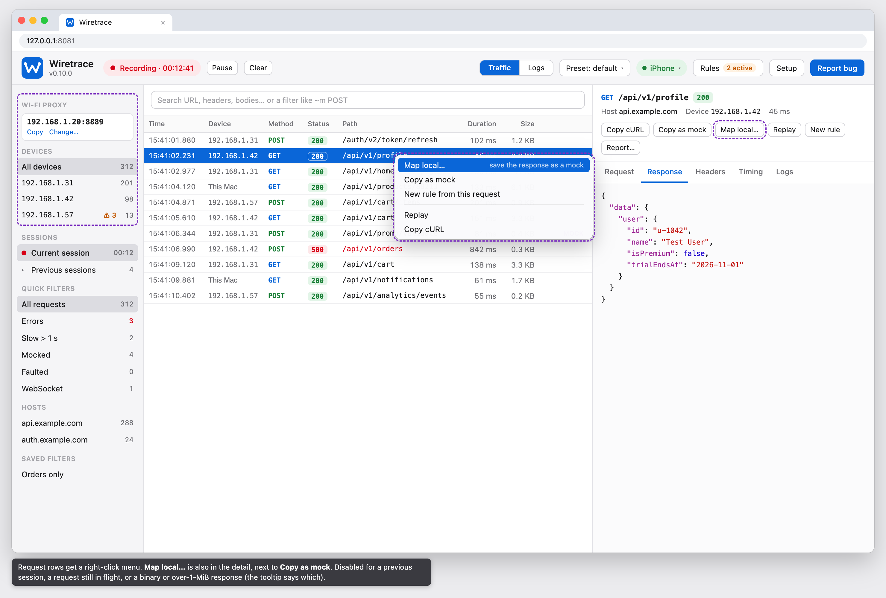

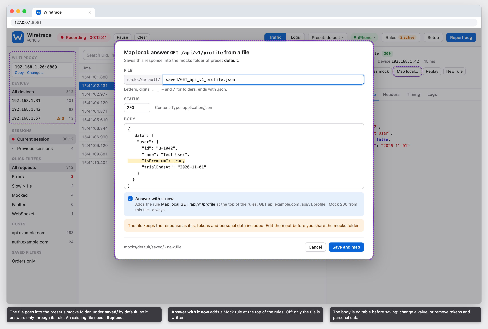

Right-click a request (or **Map local…** in the detail): the response, editable, is saved under `mocks/<preset>/saved/` and, with **Answer with it now**, a Mock rule using it goes to the top of the rules.
